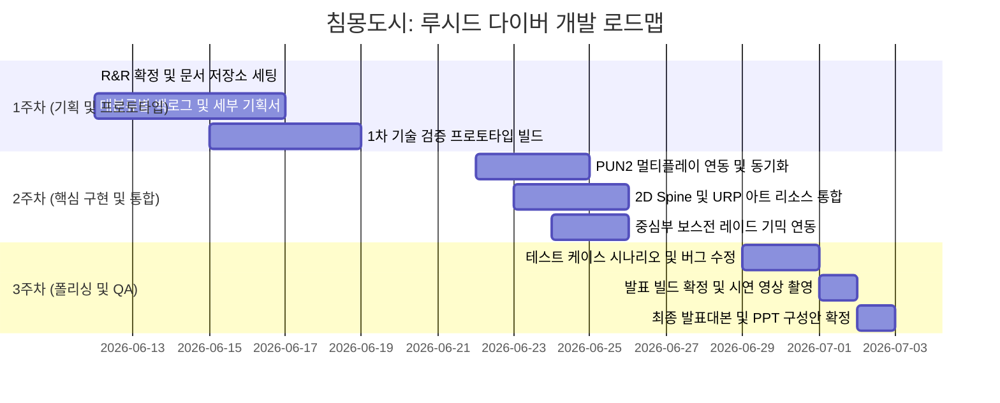


<b>침몽도시: 루시드 다이버 — 중간 점검 및 에셋 검토 회의</b> 2026-06-18

## 요약

### 1) 한 줄 결론 (TL;DR)

- 기획서 제출 일정 확정(06.19 15:00), 피드백 후 재제출(06.19 20:50), 06.22 전자서명 진행 / 3D 마트 에셋(Modular Retail) 우선 선정, 2D 에셋 병행 검토

### 2) 회의 개요

- 일시: 2026-06-18 (목) 오전
- 회의 유형: 기획/디자인 리뷰 · 스프린트 플래닝
- 목적: 기획서 제출 일정 확인, 에셋 선정, 프로젝트 관리 원칙 공유
- 참석자/역할:
  - 장수영 - CP (Chief Producer) / 레벨 기획 (팀장)
  - 우성혁 - CD (Creative Director) / 시스템 기획
  - 작성자 - PD (Project Director/Producer) / 시나리오 기획
  - 송예찬 - PM (Project Manager) / 컨셉 기획
  - 강다영 - TD (Technical Director) / 개발
- 안건(의제):
  - 기획서 완성본 제출 일정 및 피드백 프로세스 확정
  - 게임 에셋(3D/2D) 선정 및 구매 방식 결정
  - 일정표 작성 도구 및 작성 원칙 안내
  - 기획서 서명 및 변경 통제 규칙 교육
  - 프로젝트 리스크 관리 및 비상 대응 방안

### 3) 일정 체크 (Milestone Check)

- <b>현재 기준 단계/주차:</b> 1주차(06.12\~06.19) / P0 필수 기획 완료 단계
- <b>이번 주(또는 이번 단계) 완료 기준(Definition of Done):</b>
  - 06.19(금) 15:00까지 게임 기획서 완성본 제출
  - 15:00\~17:50 기획서 분석 및 피드백
  - 20:50까지 피드백 반영 기획서 최종본 제출
  - 06.22(월) 기획서 최종본 전원 전자서명 진행
- <b>이번 회의로 확정된 '다음 점검일/데모'</b>
  - 06.19(금) 15:00 — 기획서 완성본 제출 및 검수 시작 — 전원
  - 06.19(금) 17:50 — 피드백 세션 완료 — 전원
  - 06.22(월) — 기획서 전자서명 및 게임 프로젝트 공식 진행 — 전원

### 4) 범위/우선순위 통제 규칙 확인 (Scope Control)

- <b>현재 상태 판정:</b> P0 기획 확정 단계
- <b>P0.5 통제 규칙 관련 확인</b>
  - 기획서 전자서명 이후 변경 통제 원칙 확립: 서명 완료된 기획서는 물리적/기술적 불가능 사유 외 변경 불가
  - 변경 발생 시 비용(예산, 일정, 위약금) 증가 및 해당 부서 인센티브 차감 가능성 공유
  - 천재지변/인재지변(팀원 이탈, 사고 등) 예외 상황 대비 필요
- <b>기능 동결(07.18 이후) 관련 확인</b>
  - 동결 이후 허용 변경 범위: 미논의
  - 예외 필요 시: 미정

### 5) 결정 사항 (Decision Log)

- <b>결정: 기획서 제출 및 피드백 일정</b>
  - 근거/맥락: 기획서 완성 후 충분한 검토 및 수정 시간 확보 필요
  - 영향 범위: 일정 / 리소스
  - 반영 대상: 주별 일정표 / 일별 일정표
- <b>결정: 게임 기획서 전자서명 진행</b>
  - 근거/맥락: 온라인 전자서명으로 효율성 제고, 기획서 변경 통제 및 책임 명확화
  - 영향 범위: 범위 / 일정
  - 반영 대상: 전체 일정표 / 기획서
- <b>결정: 3D 에셋 1차 선정 — Modular Retail (마트 에셋)</b>
  - 근거/맥락: 단일 에셋으로 테스트 맵 전체 구현 가능, 모듈화로 맵 커스터마이징 용이, 팀 전원 동의
  - 영향 범위: 리소스 / 기술 / QA
  - 반영 대상: 레벨 기획 문서 / 에셋 구매 리스트
- <b>결정: 2D/3D 혼용 방식 기술 검토 진행</b>
  - 근거/맥락: 2D 배경 + 3D 오브젝트 혼용 시 툰 쉐이더/URP 2D 라이트 컴포넌트 활용 가능성 확인 필요
  - 영향 범위: 기술 / 리소스
  - 반영 대상: 기술 문서
- <b>결정: 일정표는 Visio 간트차트 또는 </b>`Draw.io`<b>로 작성</b>
  - 근거/맥락: 엑셀/파워포인트 대비 전문성 및 가독성 향상
  - 영향 범위: 일정
  - 반영 대상: 전체 일정표 작성 방식
- <b>보류: 유료 에셋 구매 방식</b>
  - 다음 회의에서 결정할 기준/필요 자료: 엘리스(Alice) 측 일괄 구매 후 패키지 배포 방식 vs 개인 선결제 후 환급 방식 결정 필요
  - 담당/기한: 엘리스 담당자 / 06.19 17:50까지
- <b>보류: 캐릭터 에셋 선정</b>
  - 다음 회의에서 결정할 기준/필요 자료: 서브컬처 캐릭터 에셋 조사 또는 직접 제작(2D 애니메이션) 방식 결정
  - 담당/기한: 작성자 / 추후 확정

### 6) 액션 아이템 (Action Items → 티켓화 기준)

- [ ] 장수영 — P0 기획서 최종 검수 및 제출 — <b>산출물: P0 정의서, 시스템 기획서 정합성 확인 완료</b> — <b>06.19(금) 15:00</b>
- [ ] 우성혁 — P0 시스템 기획서 수정본 제출 — <b>산출물: 기억 파편/소비 기물/퀵슬롯/탈출/정산 규칙 반영본</b> — <b>06.19(금) 15:00</b>
- [ ] 작성자 — P0 텍스트 리소스 제출 — <b>산출물: 기록 01, 결과창 문구, 귀환 대사 최소 세트</b> — <b>06.19(금) 15:00</b>
- [ ] 작성자 — 에셋 선정 문서 작성 — <b>산출물: 확정 에셋 리스트 문서</b> — <b>06.19(금) 17:50</b>
- [ ] 송예찬 — P0 리소스 요구 명세 제출 — <b>산출물: 아이콘/초상화/UI 톤 요구사항</b> — <b>06.19(금) 15:00</b>
- [ ] 송예찬 — Visio 간트차트 기반 일정표 작성 — <b>산출물: 전체 프로젝트 일정표</b> — <b>06.22(월) 킥오프 전</b>
- [ ] 강다영 — 개발 작업 분해 검토 — <b>산출물: 06.23\~06.27 구현 티켓 난이도/순서 검토 완료</b> — <b>06.22(월) 킥오프 전</b>
- [ ] 강다영 — 2D/3D 혼용 기술 검증 — <b>산출물: 툰 쉐이더, URP 2D 라이트, 벽 렌더링 컬링 방식 기술 검토 보고</b> — <b>추후 확정</b>
- [ ] 전원 — 06.19(금) 15:00\~17:50 기획서 피드백 세션 참여 — <b>완료조건: 피드백 반영 사항 정리</b> — <b>06.19(금) 17:50</b>
- [ ] 전원 — 06.19(금) 20:50까지 피드백 반영 기획서 재제출 — <b>완료조건: 최종본 제출 완료</b> — <b>06.19(금) 20:50</b>
- [ ] 전원 — 06.22(월) 기획서 전자서명 진행 — <b>완료조건: 전원 서명 완료</b> — <b>06.22(월)</b>

### 7) 변경 사항/업데이트 (Schedule / Spec Change Log)

- <b>변경 요약:</b> 기획서 제출 및 피드백 일정 상세화, 에셋 선정 1차 확정
- <b>변경 전 → 변경 후</b>
  - 기획서 제출 일정: 미확정 → 06.19(금) 15:00 제출, 17:50 피드백, 20:50 재제출 확정
  - 에셋 선정: 미정 → Modular Retail(3D 마트 에셋) 1차 선정, 2D 에셋 추가 검토 진행
  - 일정표 작성 도구: 미정 → Visio 간트차트 또는 `Draw.io` 확정
- <b>영향 받는 마일스톤/검수:</b> 06.19 기획서 제출, 06.22 전자서명 및 개발 킥오프

### 8) 리스크 & 블로커 (Risks / Blockers)

- \[리스크\] 기획서 변경 발생 시 비용/일정 증가 — 영향: 일정/품질/예산 — 대응/완화: 전자서명 후 변경 통제 원칙 엄격 적용, 물리적/기술적 불가능 사유 외 변경 불가 — 오너: 전원 — 지속 관리
- \[리스크\] 팀원 이탈/사고 등 불가항력 상황 — 영향: 일정/품질 — 대응/완화: 비상 상황 대비 일정 여유 확보, 역할 분산 — 오너: 장수영(PM) — 지속 관리
- \[리스크\] 2D/3D 에셋 혼용 시 이질감 발생 가능성 — 영향: 품질 — 대응/완화: 툰 쉐이더 적용, URP 2D 라이트 컴포넌트 활용 기술 검증 — 오너: 강다영 — 추후 확정
- \[리스크\] 일정표 작성 시 과도하게 빡빡한 일정 구성 가능성 — 영향: 일정/품질 — 대응/완화: 리허설/점검 시간 확보, 여유 있는 일정 구성 원칙 적용 — 오너: 송예찬 — 06.22 킥오프 전
- \[블로커\] 유료 에셋 구매 방식 미확정 — 필요한 도움/결정: 엘리스 측 구매 방식 확정 필요 — 요청 대상: 엘리스 담당자 — 데드라인: 06.19(금) 17:50

### 9) 다음 단계 (Next Steps)

- <b>다음 회의 전까지 확정해야 할 것</b>
  - 유료 에셋 구매 방식 최종 결정 — 담당: 엘리스 담당자 — 기한: 06.19 17:50
  - 에셋 선정 문서 작성 완료 — 담당: 작성자 — 기한: 06.19 17:50
  - 기획서 피드백 반영 완료 — 담당: 전원 — 기한: 06.19 20:50
- <b>다음 회의 안건 초안</b>
  - 06.22(월) 개발 킥오프: 구현 티켓 우선순위 확정, 역할 분담 재조정, 기획서 전자서명 진행

---

## 📋 06.19(금) 일별 일정표

<table fit-page-width="true" header-row="true">
<tr>
<td>
날짜
</td>
<td>
담당자
</td>
<td>
역할/직책
</td>
<td>
오늘 작업
</td>
<td>
완료 기준
</td>
</tr>
<tr>
<td>
06.19
</td>
<td>
장수영
</td>
<td>
레
</td>
<td></td>
<td></td>
</tr>
<tr>
<td>
06.19
</td>
<td>
우성혁
</td>
<td>
시스템 기획 / CD
</td>
<td>
P0 시스템 기획서 수정본 제출
</td>
<td>
기억 파편/소비 기물/퀵슬롯/탈출/정산 규칙 반영본 15:00 제출
</td>
</tr>
<tr>
<td>
06.19
</td>
<td>
김남해
</td>
<td>
시나리오 기획 / PD
</td>
<td>
P0 텍스트 리소스
</td>
<td></td>
</tr>
<tr>
<td>
06.19
</td>
<td>
송예찬
</td>
<td>
컨셉 기획 / PM
</td>
<td>
P0 리소스 요구 명세 제출, 일정표 작성 착수
</td>
<td></td>
</tr>
<tr>
<td>
06.19
</td>
<td>
강다영
</td>
<td>
개발 / TD
</td>
<td>
개발 착수용 기술 작업 분해 검토
</td>
<td>
06.23\~06.27 구현 티켓의 난
</td>
</tr>
</table>

## 메모

20260619 15:00 게임 기획서 완성본 제출<br />17:50 게임기획서 완성본 피드백<br />20:50 피드백 받은 게임기획서 완성본 제출<br />20260622 게임 기획서 최종본 전원 전자서명 진행, 게임프로젝트 진행

필요한 유료에셋 찾은후 제출 기한 (최소 P0 프로토타입에 필요한 에셋들 찾을 필요 있음)

하루 전이라도 리허설이나 점검할 수 있는 시간을 마련하자<br />매주 그 주에 했던 일을 점검하고 재정비할 시간을 넣으면 좋을 것 같다.<br />

<b>장수영 (CP - Chief Producer)</b>

<b>우성혁 (CD - Creative Director)</b>

<b>김남해 (PD - Project Director / Producer)</b>

<b>송예찬 (PM - Project Manager)</b>

<b>강다영 (TD - Technical Director)</b>

코치님이 정해주신 역할을 기준으로 현재 할당된 작업과 역할을 다시 정리할 필요가 있어 보임. CP, CD 같은 호칭별 구분을 무엇이라고 불러야 할지는 아직 모르겠음. 개발과 기획에 인력을 나누어야 하므로, CP님이 만든 개발 로드맵과 마일스톤을 활용해 역할을 나눌 필요성은 있어 보임.

비지오의 간트차트를 이용해서 만들어 볼 것, 정 안 되면 Draw.io를 사용해서 만들 것

````markdown
> [!IMPORTANT]
> **문서의 지위 및 우선순위**
> 본 문서는 `침몽도시: 루시드 다이버` 최종 프로토타입 빌드의 구현 범위를 확정하는 최상위 단일 진실 공급원(SSOT)입니다.
> 타 문서와 충돌이 발생할 경우 본 문서의 명세가 가장 우선적으로 적용됩니다.

# 최종_프로토타입_P0_정의서

## 1. 문서 목적
본 문서는 `침몽도시: 루시드 다이버` 최종 프로토타입 빌드에서 반드시 구현해야 하는 **P0 최소 검증 범위**를 정의하는 마스터 정의서(SSOT)입니다.
현재 프로젝트의 개발 목표는 완성형 게임의 전체 시스템을 구축하는 것이 아니며, 메인 다이버 1명을 중심으로 **'PvE 익스트랙션 루프'와 '서브컬처 캐릭터 애착 루프'가 실질적으로 결합될 수 있음을 증명하는 포트폴리오용 빌드**를 제작하는 것입니다. 
이에 따라 본 문서는 지금까지 파편화되어 작성된 다양한 기획 문서(세계관, 시나리오, 시스템, UI 등) 중에서 **이번 프로토타입에서 반드시 구현되어야 할 피처만을 고정**하여 기획 및 개발의 혼선을 방지하고자 합니다.

## 2. 최종 P0 검증 목표
본 프로토타입 빌드에서 입증하고자 하는 핵심 질문은 다음과 같습니다.
> *"익스트랙션 플레이를 통해 회수한 보상이 서브컬처 캐릭터 애착 보상과 다음 출격 준비로 이어질 수 있는가?"*

플레이어는 아래 정의된 두 가지의 핵심 결합 루프를 하나의 게임 사이클 내에서 유기적으로 경험해야 합니다.

### 2.1 서브컬처 캐릭터 애착 루프
```text
기억 파편 획득 
→ 탈출 성공 
→ 기억 파편 자동 사용 
→ 동조율 상승 
→ 개인 심상 기록 01 해금 
→ 로비 복귀 후 다이버/기록 메뉴에서 선택 감상 
→ 귀환 대사 변화
```

### 2.2 PvE 익스트랙션 루프
```text
마나석 / 회복약 획득 
→ 탈출 성공 
→ 창고 저장 
→ 다음 출격 소지품 슬롯에 장착 
→ 다음 세션에서 사용 가능
```

## 3. 최종 P0 플레이 플로우
프로토타입의 전체 플레이 진행 단계 및 화면 전이 흐름은 다음과 같습니다.
```text
로비
→ 출격 준비
→ 침몽도시 세션 진입
→ 이동 / 조준 / 공격
→ 적과 조우
→ 기억 파편, 마나석, 회복약 획득
→ 전화부스 탈출 시도
→ 탈출 성공 또는 강제 각성
→ 결과창 정산
→ 로비 복귀
→ 다이버 메뉴에서 심상 기록 확인
→ 창고에서 회수품 확인 및 다음 출격 준비
```

## 4. P0 필수 구현 범위

| 구분 | P0 항목 | 설명 | 완료 기준 |
| :--- | :--- | :--- | :--- |
| **로비 / 관제실** | 로비 메인 화면 UI | 다이버 초상화/스탠딩 1장, 다이버 이름, 현재 동조율 단계 및 귀환 대사 표시. 출격/다이버/창고 버튼 제공. 새 기록 해금 시 알림(NEW) 표시. | 유저가 로비에서 출격, 다이버/기록, 창고 메뉴로 정상 이동 가능하며, 세션 성패 결과에 따라 복귀 시 다이버 대사가 동적으로 변화한다. |
| **출격 준비** | 장비 장착 UI 패널 | 메인 다이버의 간략 정보 및 다음 출격 시 지참할 소모품 장착용 2개 슬롯 표시. [출격] 및 [창고에서 변경]/[뒤로] 단추 배치. | 유저가 다음 세션에 지참할 소모품 2종의 현황을 확인하고 안정적으로 세션 씬에 진입할 수 있다. |
| **인게임 세션** | 플레이 공간 및 기본 액션 | 2.5D 탑다운 시점의 단일 테스트 맵. 플레이어 WASD 이동, 마우스 조준 사격, HP/마나 시스템 구현. 몬스터 1종(추적/공격 AI 적용), 파밍용 아이템 3종(기억 파편, 마나석, 회복약) 배치 및 충돌 획득 처리. 전화부스 탈출 구역 배치. | 유저가 세션에 진입하여 조작/전투/파밍을 정상 수행하고, 전화부스를 통하거나 플레이어 사망을 통해 세션을 종료시킬 수 있다. |
| **아이템** | 기억 파편 | 창고에 저장하지 않고 정산 성공 시 자동 소모되는 자원. 실패 시 유실. | 기억 파편은 아웃게임에서 서사 보상(동조율 상승 및 기록 해금)을 트리거하는 자원으로만 처리된다. |
| **아이템** | 마나석 | 세션 중 획득하여 탈출 성공 시 창고에 누적 저장. 실패 시 유실. 소지품 장착이 가능하며 세션 내 사용 시 마나 회복. *(※ 사용 기능 개발 부담 시 창고 저장/장착 표시까지만 구현 가능)* | 마나석은 안전하게 회수하여 다음 출격에 사용할 수 있는 익스트랙션 회수 자원으로 작동한다. |
| **아이템** | 회복약 | 세션 중 획득하여 탈출 성공 시 창고에 누적 저장. 실패 시 유실. 소지품 장착이 가능하며 세션 내 사용 시 HP 회복. *(※ 사용 기능 개발 부담 시 창고 저장/장착 표시까지만 구현 가능)* | 회복약은 안전하게 회수하여 다음 출격에 사용할 수 있는 익스트랙션 회수 자원으로 작동한다. |
| **결과창** | 세션 정산 UI | 탈출 성공/실패 배너, 플레이 타임, 획득 파편 수, 파편 자동 소모 안내, 동조율 단계 변화(Lv.0 → Lv.1), 기록 01 해금 상태, 회수한 마나석/회복약 창고 저장 개수 표시. 세션 결과별 다이버 전용 대사 출력. [로비로 돌아가기] 단추 배치. | 결과창 화면 내에 서브컬처 서사 보상과 익스트랙션 파밍 보상이 시각적 영역으로 명확히 구분되어 정산 표시된다. |
| **다이버 / 기록** | 다이버 상세 UI | 메인 다이버 이름 및 초상화, 현재 동조율 단계 노출. 개인 심상 기록 01의 잠금/해금 상태 가시화 및 열람 기능 제공. 기록 02는 더미 잠금 처리. 뒤로 가기 단추 구현. | 유저가 로비에서 직접 다이버 메뉴에 진입하여 해금 완료된 시나리오 기록을 선택적으로 읽어볼 수 있다. |
| **창고 / 인벤토리**| 회수품 관리 UI | 보관 중인 마나석/회복약 개수 표시, 다음 출격에 지참할 고정 슬롯 2개 가시화. 기억 파편의 자동 소모 서사 자원 안내 텍스트 탑재. [소지품 설정] 및 뒤로 가기 단추 구현. | 유저가 세션에서 안전하게 획득한 일반 소모품의 수량을 창고에서 파악하고 다음 세션을 준비하는 소지 장착으로 연결할 수 있다. |
| **대사 / 텍스트** | 연출 스크립트 | 세션 시작/적 발견/피격/파편 획득/소모품 획득/탈출 성공/실패/로비 귀환/기록 해금 대사 및 개인 심상 기록 01 시나리오 텍스트 원문 제공. | 상황별 캐릭터 대사가 짧고 명확하게 출력되며, 전문용어를 최소화하고 감정과 조작 행동 위주로 가독성 높게 표기된다. |

### 4.8.1 상황별 대사 및 텍스트 작성 가이드
- **작성 원칙**: 대사는 한 문장 단위로 간결하게 구성하며, 전문 세계관 용어는 단일 문장당 1개 이하로 제한합니다. 설정에 대한 장황한 연출보다 상황에 대한 감정적 피드백과 조작 안내를 우선시합니다.

---

## 5. P0에서 제외할 항목
아래에 정의된 항목들은 이번 최종 프로토타입 P0 스펙에서 완전히 제외되며, 아웃게임 및 인게임 내에서 더미 UI 형태로만 표시되거나 아예 구현하지 않습니다.

| 제외 항목 | 처리 위치 | 사유 |
| :--- | :--- | :--- |
| **다이버 영입 / 가챠 / 교체** | 아웃게임 메뉴 전체 | 다이버 1인 고정 빌드이므로 캐릭터 추가 획득 및 교체 UI 불필요 |
| **1+2 스트라이커 편성 및 호출** | 인게임 및 아웃게임 | 스쿼드 동기화 및 2인 지원 캐릭터 스킬 호출 리소스 배제 |
| **호감도 선물 및 다단계 성장** | 아웃게임 상상/로비 | 복잡한 성장 곡선 및 선물 수납 UI 구현 비용 제거 |
| **스킨 및 코스튬 변경** | 로비 및 다이버 화면 | 추가적인 리소스 작업 최소화 및 비주얼 BM 검증 불필요 |
| **상점 및 크래프팅 공방** | 아웃게임 허브 메뉴 | 재화 거래 로직 및 기재 재료 조합 연산 로직 배제 |
| **아이템 판매 및 분해** | 창고 / 인벤토리 화면 | 획득품의 일방적인 저장/사용 루프만 검증하므로 상호 거래 제외 |
| **방어구 및 정신 방벽** | 인게임 HUD 및 캐릭터 | HP/마나 이외의 생존 스탯 배제 및 기획 연산 단순화 |
| **인벤토리 그리드 및 드래그** | 창고 / 인벤토리 화면 | 타르코프식 2D 격자 수납을 전면 배제하고 슬롯형 카운트만 유지 |
| **장비 및 무기 강화** | 아웃게임 무장 메뉴 | 무기 레벨업 및 부품 조합 시스템 구현 비용 제거 |
| **보스전 및 침식 위상 변화** | 인게임 레벨 및 몬스터 AI | 기본 일반 몹 1종의 추적/사격 상태 머신으로 FSM 단순화 |
| **멀티플레이 대기방 및 소생** | 게임 네트워킹 전체 | 네트워크 동기화 비용을 없애고 싱글 플레이 샌드박스로 구성 |
| **세션 시간 제한 / 시간 가속** | 인게임 세션 루프 | 침식 확장 디버프 적용 연산을 배제하고 탈출 성패에만 집중 |
| **Live2D / 풀 보이스 / 연출 컷인**| 아웃게임 및 인게임 UI | 비주얼 리소스 비용을 절감하고 마크다운/텍스트 피드백으로 대체 |

---

## 6. P0.5 선택 구현
일정상의 여유가 있는 경우에 한하여 선택적으로 추가 구현을 시도하며, 빌드 평가 시 미구현으로 인한 불이익은 존재하지 않습니다.
- 개인 심상 기록 01 해금 시점의 개방 이펙트 및 효과음
- 로비 메인 내 다이버 메뉴 버튼 옆 `NEW` 알림 빨간 점 활성화
- 결과창 진입 시 각 항목이 위에서 아래로 순차 등장하는 시간차 애니메이션
- 대사 성격에 따른 캐릭터 일러스트 표정 변화(차분 스위칭)
- 마나석/회복약 사용 시의 모션 애니메이션 및 재사용 대기 시간(쿨타임) HUD 표시
- 결과창 내에서 즉시 세션을 반복 진입하게 돕는 `[Retry (다시 하기)]` 버튼 구현
- 기록 01 뷰어 화면의 디자인 및 시각 연출 보강
- 세션 실패 시 결과창에 특정 기억 조각의 획득 장소 힌트(시나리오 텍스트)를 제공하는 기능
- 무기 잔탄 보충을 위한 보조 소모품 '탄약팩' 구현
- 세션 중 획득 가능한 일회성 특수 총기인 '임시 무장' 구현

---

## 7. P0 변수표
프로토타입 시스템 작동 및 데이터 연동에 관여하는 핵심 변수 19종 목록입니다.

| 변수명 | 자료형 | 사용 위치 | 설명 |
| :--- | :--- | :--- | :--- |
| `sessionState` | enum | 게임 매니저 | 현재 공간 및 모드 제어 (`LOBBY`, `IN_GAME`, `RESULT`) |
| `extractionResult` | enum/bool | 결과창, 게임 매니저 | 세션 종료 성패 결과 (`SUCCESS` / `FAILED`) |
| `playTime` | float/string | 결과창, 인게임 HUD | 세션 내에서 탈출 성공 혹은 사망 시점까지의 기록 시간 |
| `memoryFragmentCount` | int | 세션 플레이, 결과창 | 이번 세션에서 플레이어가 안전하게 회수한 기억 파편 수 |
| `memoryFragmentUsedForMemoryLog` | bool | 결과창, 결과 정산기 | 이번 정산 시 기억 파편이 기록 복구에 자동 사용되었는지 여부 |
| `linkRateLevel` | int | 로비, 결과창, 다이버 | 다이버와의 동조율 단계 (기본값: 0) |
| `linkRateGain` | int | 결과 정산기 | 세션 탈출 성공 시 가산되는 동조율 단계 증가치 (기본값: +1) |
| `memoryLogUnlocked` | bool | 결과창, 다이버 상세 | 개인 심상 기록 01의 해금 여부 플래그 (`true` 시 뷰어 개방) |
| `hasNewMemoryLog` | bool | 로비 메인 UI | 새로 해금된 기록이 존재함을 가리키는 알림 마크 활성화 여부 |
| `manaStoneCount` | int | 세션 플레이, 결과창 | 이번 세션에서 플레이어가 파밍하여 탈출 성공한 마나석 개수 |
| `potionCount` | int | 세션 플레이, 결과창 | 이번 세션에서 플레이어가 파밍하여 탈출 성공한 회복약 개수 |
| `storedManaStoneCount` | int | 창고, 출격 준비 | 창고 인벤토리에 보존된 마나석 총량 (세션 성공 시 누적 합산) |
| `storedPotionCount` | int | 창고, 출격 준비 | 창고 인벤토리에 보존된 회복약 총량 (세션 성공 시 누적 합산) |
| `equippedItemSlot1` | string | 창고, 출격 준비, 인게임 | 다음 세션에 지참할 소지품 슬롯 1번의 아이템 ID |
| `equippedItemSlot2` | string | 창고, 출격 준비, 인게임 | 다음 세션에 지참할 소지품 슬롯 2번의 아이템 ID |
| `currentDialogueID` | string | 로비 메인 | 현재 로비 화면 텍스트 박스에 표시할 다이버 대사의 ID |
| `returnDialogueID` | string | 결과창, 로비 복귀 | 세션 종료 판정에 따라 로비 복귀 시 출력해야 할 귀환 대사 ID |
| `playerHP` | float | 세션 플레이, 인게임 HUD | 인게임 플레이어 다이버의 생명력 수치 (0 이하 시 FAILED) |
| `playerMana` | float | 세션 플레이, 인게임 HUD | 인게임 플레이어 다이버의 마나 수치 (사격 시 차감 및 마나석 사용 시 회복) |

---

## 8. P0 완료 체크리스트
프로토타입 빌드가 완료 및 정상 판정되기 위해 충족해야 하는 검증 항목 목록입니다.

| 체크 항목 | 성공 기준 | 담당 파트 |
| :--- | :--- | :---: |
| **로비 UI 전이** | 로비에서 출격 단추 클릭 시 출격 준비 화면으로 문제없이 이동한다. | UI / 클라이언트 |
| **세션 진입** | 출격 준비 화면에서 최종 출격 단추를 누르면 인게임 세션 씬이 정상 로드된다. | 클라이언트 / 레벨 |
| **캐릭터 조작** | 플레이어가 WASD 입력으로 이동하고 마우스 조향에 따라 총구를 조준할 수 있다. | 클라이언트 / 조작 |
| **기본 공격** | 마우스 좌클릭 시 지정 탄환이 발사되며 마나 소모 및 장전 메커니즘이 작동한다. | 클라이언트 / 전투 |
| **적 추적 AI** | 적 1종이 스폰된 후 감지 반경 내 플레이어를 인지하여 대상을 추적한다. | AI / 클라이언트 |
| **전투 피격** | 적의 사격/공격 범위 내에서 플레이어가 타격당할 시 `playerHP`가 실시간 차감된다. | AI / 전투 |
| **파편 파밍** | 맵 상에 드롭된 기억 파편을 플레이어가 충돌 획득할 시 획득 카운트가 정상 상승한다. | 레벨 / 아이템 |
| **마나석 파밍** | 맵 상에 드롭된 마나석을 플레이어가 충돌 획득할 시 획득 카운트가 정상 상승한다. | 레벨 / 아이템 |
| **회복약 파밍** | 맵 상에 드롭된 회복약을 플레이어가 충돌 획득할 시 획득 카운트가 정상 상승한다. | 레벨 / 아이템 |
| **전화부스 탈출** | 탈출용 전화부스 오브젝트와 충돌 상호작용 시 탈출 성공 결과창으로 정상 전이된다. | 레벨 / UI |
| **강제 각성 처리** | `playerHP`가 0 이하로 떨어지면 사망 연출 후 즉시 실패 결과창으로 전이된다. | 전투 / UI |
| **결과창 기본 정보** | 결과창에 세션 성패 판정 배너와 함께 플레이 시간이 정상 수치로 가시화된다. | UI / 클라이언트 |
| **기억 파편 정산** | 성공 정산 시 기억 파편 개수만큼 자동 사용 처리가 수행되며 결과창에 고지된다. | UI / 기획 |
| **동조율 가산** | 탈출 성공 시 다이버의 동조율 단계가 1레벨 상승하며 결과창에 가시화된다. | UI / 기획 |
| **서사 보상 해금** | 파편 1개 이상 회수 성공 시 `memoryLogUnlocked` 플래그가 참(`true`)으로 정상 셋업된다. | 시스템 / 기획 |
| **소모품 정산** | 성공 탈출 시 획득한 마나석과 회복약이 창고 변수로 합산되어 누적 보관된다. | 시스템 / 데이터 |
| **실패 유실 처리** | 실패 결과창 진입 시 획득한 기억 파편 및 소모품이 모두 0개로 소실 정산된다. | 시스템 / 데이터 |
| **개인 기록 감상** | 로비 복귀 후 다이버 상세 메뉴에 진입하여 해금된 개인 심상 기록 01을 열람할 수 있다. | UI / 시나리오 |
| **창고 보관 확인** | 로비 창고 메뉴 진입 시 누적 보관된 마나석과 회복약 수량을 직관적으로 파악할 수 있다. | UI / 데이터 |
| **출격 소지품 세팅** | 창고 및 출격 준비 화면에서 보관 마나석/회복약을 소지 슬롯 2개에 지정 및 장착할 수 있다. | UI / 데이터 |

---

## 9. 문서 간 우선순위
본 문서는 최종 프로토타입 P0 스펙 범위를 단일하게 통제하는 기준 문서입니다. 기획서 혹은 시스템 명세서 간의 상호 내용적 충돌이 발생할 경우 반드시 아래의 우선순위에 입각하여 판단하고 구현합니다.
1. **`최종_프로토타입_P0_정의서.md` (본 문서)**
2. `프로토타입_로비_허브_UI_플로우_명세.md`
3. 시스템 기획 명세서
4. `서브컬처_캐릭터_애착_기획서.md`
5. 세계관 / 시나리오 / 캐릭터 심층 세부 기획서

※ 타 세부 시나리오나 심층 설정 기획서에 대사 및 연출이 화려하게 기술되어 있더라도, 본 정의서의 P0 구현 범위에 포함되지 않은 피처(Live2D, 1+2 편성 등)는 이번 스프린트 구현 대상에서 철저하게 제외합니다.

---

## 10. 핵심 요약
본 프로토타입의 P0는 완성형 전체 게임이 아니라, 메인 다이버 1명을 중심으로 서브컬처 애착 루프와 PvE 익스트랙션 루프가 실제로 연결되는지 검증하는 최소 구현 범위입니다.

P0에서 반드시 보여줘야 하는 핵심 가치는 다음과 같습니다.
1. **로비에서 출격한다.**
2. **세션에서 기억 파편, 마나석, 회복약을 획득한다.**
3. **전화부스로 탈출한다.**
4. **결과창에서 기억 파편은 동조율/심상 기록으로 연결된다.**
5. **마나석과 회복약은 창고에 저장된다.**
6. **로비에서 해금된 기록을 직접 확인한다.**
7. **창고에서 다음 출격 준비가 가능하다.**

이 최소 단위의 루프가 유기적으로 작동한다면, 본 프로토타입은 `서브컬처 + 익스트랙션` 핵심 플레이 루프의 연계 가치를 명확히 검증하는 데 성공한 것으로 판단합니다.

---

## 📜 Revision History
| 날짜 | 버전 | 내용 | 작성자 |
| :---: | :---: | :--- | :---: |
| 2026.06.17 | v1.00 | - 프로토타입 P0 마스터 명세(SSOT) 초안 작성 및 등록 | 장수영 |
````

````markdown
# 🗺️ 3차 프로젝트 마일스톤 및 개발 로드맵

> **본 로드맵은 《침몽도시: 루시드 다이버》 개발을 위한 전체 일정표 및 팀원별 마일스톤입니다.**
> 1차 기획 및 프로토타입 검증부터 최종 발표용 빌드 구축까지의 과정을 관리합니다.

---

## 📅 전체 마일스톤 (Milestones)



### 1주차 주요 마일스톤 목표 (06.12 ~ 06.19)
*   **[P0] 필수 기획 완료**: 6월 17일(수) 퇴근 시까지 각 역할별 세부 기획서 1차 완료.
*   **[P0] 1차 프로토타입 구축 및 기획 확정**: 6월 19일(금) 퇴근 시까지.
    *   *프로토타입 스펙*: Unity 3D 기본 프리미티브(오브젝트)를 사용한 캐릭터 조작, 실시간 기물 획득 및 무장 변형, 안전 보존 슬롯 인벤토리 룰 검증 빌드.

---

## 🧑‍💻 팀원별 세부 로드맵 & R&R (Role & Responsibility)

| 팀원 | 역할 | 1주차 (기획 및 검증) | 2주차 (구현 및 동기화) | 3주차 (디버깅 및 폴리싱) | 최종 산출물 경로 |
|:---:|:---:|:---|:---|:---|:---|
| **강다영** | Git & 개발 세팅 | Unity 2022.3.62f3 및 URP 초기 세팅, 브랜치 전략 확립, 씬 구조화 | PUN2 로비 매칭 및 세션 룸 입장 로직 구현 | 네트워크 트래픽 최적화, 빌드 및 배포 자동화 | `02.기술_문서/` |
| **송예찬** | 컨셉 기획 | 게임 월드 톤앤매너, 캐릭터 원화 컨셉, 1차 기물 무기(우산/시계/거울) 아트 요구사항 작성 | 추가 기물 아트 리소스 팩 수급, 2D 스프라이트 시각 효과 레퍼런스 정리 | UI/UX 비주얼 이펙트 리소스 가공 및 폴리싱 | `01.기획_문서/컨셉_기획/` |
| **김남해** | 시나리오 기획 | 침몽도시 배경 시나리오, 루시드 다이버 및 에너지 코어 내러티브 설정, 시스템의 개연성 보완 | 튜토리얼 스크립트 작성, 퀘스트 대화 로그 구성 | 시연용 스토리 컷씬 구성 보조 및 오타 교정 | `01.기획_문서/시나리오_및_세계관/` |
| **우성혁** | 시스템 기획 | 1+2+1 파티 편성 시너지(공명), 각성 보존 슬롯(안전 금고) 로직 설계, 기물 무장 내구도 밸런스 수립 | PUN2 기반 아이템 루팅 및 내구도 동기화 설계, 보스전 그로기/부위파괴 시스템 구체화 | 인게임 전투 밸런스 데이터 튜닝, QA 버그 대장 리포팅 및 검수 | `01.기획_문서/시스템_명세/` |
| **장수영** | 레벨 기획 (팀장) | 프로토타입 테마 맵 '꿈에 먹힌 상가 구역' 구역별 레이아웃 동선 설계 및 장애물 배치 규칙 작성 | 외곽-중간-중심부 보스룸 레벨 구현, 난이도별 적 리스폰 트리거 배치 | 맵 라이팅(URP), 포스트 프로세싱 연출 조정, QA 최종 검수 진행 | `01.기획_문서/레벨_기획/` |

---

## 📢 일정 및 산출물 관리 원칙
1. **SSOT(Single Source of Truth) 원칙**: 로드맵 및 일정의 진행 현황은 Notion에 1차 기록하되, 최종 확정된 기술 및 기획 명세서는 반드시 본 저장소의 마크다운(.md) 파일 형태로 이관하여 버전 관리를 수행합니다.
2. **AI Co-PM 활용**: 문서가 업데이트되거나 일정이 수정될 경우, `PROJECT_CONTEXT.md`와 본 `프로젝트_로드맵.md`를 갱신하여 Antigravity가 팀의 진행도를 실시간으로 추적할 수 있도록 지원합니다.

---

## 📜 Revision History

| 날짜 | 버전 | 내용 | 작성자 |
|------|------|------|--------|
| 2026-06-12 | v1.0 | - 《침몽도시: 루시드 다이버》 1~3주차 전체 일정 및 팀원 R&R 로드맵 수립 | Antigravity |
| 2026-06-12 | v1.1 | - 프로토타입 테마 맵 명칭 변경 반영 (꿈에 먹힌 지하상가 ➡️ 꿈에 먹힌 상가 구역) | Antigravity |

````


<details markdown="1">
<summary>전체 받아쓰기 펼치기</summary>


자 그럼 중간 점검좀 할게요 내일까지 그 기획서 문제 없나요?

오늘 목요일이잖아요. 그쵸? 네. 문제없습니다. 문제없습니까? 네. 몇시까지 하면 될까요?

네, 점심시간 전까지는 될 것 같습니다. 그러면, 기획서를 우리가 분평해를 좀 해야하니까

점심 먹고 와서 그냥 뭐 스크럽 이런건 없잖아요 그죠? 그러면 3시에, 3시까지 제출하고요 3시까지 제출하고 그 다음 기획서 전달 받은거 같이 마지막 마무리 합시다 그렇게 하면 되겠죠 네, 알겠습니다.

왕만두는 너무 커

시간을 정해놓고 할께요

시야를 좀 많이 그릴겁니다. 왜냐하면 하나하나 다 뜯어봐야되잖아요. 컨셉, 시나리오, 시템 레벨, 전체적인 일정, 포스트 타이트, 아스터버전, 구현 현황까지 기술적으로 가능한지 다 질문도 해봐야되고 하니까 마무리가 되면 피드백 받은 내용으로

자 몇시까지 제출하면 될까요? 크게 변동상이 없을것 같아서 그날 제출해주면 좋을것 같아요.

이렇게 하면 되겠죠?

그리고 회의록 작성해야 됩니다. 내가 지금 원하는 요거에요. 요거에만 하면 EX대로만

그리고 월요일날 이 기획서에 전부 다 싸인할거에요. 싸인은 어떻게 하냐면 요즘에는 오프라인으로 안하고 어떻게 하냐면 온라인으로 전부 다 싸인 가능합니다. 그래서 그런것도 한번 배워보세요. 옛날에는 무조건 만나서 종이에다 싸인하고 그랬는데 이제 그래 안하고요. 온라인으로 싸인 가능하니까 그렇게도 한번 진행을 해볼게요.

오늘이 며칠이지? 월요일이. 22일이네.

자 이제 이렇게 하면 뭐 바꿉니다 이렇게 하면

그 전에 한번 기회가 되가지고 동경게임쇼 갔지만, 거기 유캡 개발자들이 좀 많이 왔더라구요.

거기는 업무로 한국사람도 있었어요. 그래서 다행히 영어 아니고 한국말로 UBI 소프트에서 게임 만들던 사람하고 스프린트셀하고 이런거 만든 사람이 있었어요.

나랑 동갑이고 그래가지고 지스타 가서 좀 친해졌어요 그냥 이래저래 이야기를 나누는데 그건 어떻게 하냐 물어봤더니 나는 게임기획서가 나오면 이 핵심 개발자들은 거기다 다 싸인을 한대요. 왜? 절대 못 바꾸게 한대요. 어떠한 일이 있어서. 왜냐면 뭐가 변경이 되면 어떤 일이 생깁니까, 여러분?

제일 참 무슨 큰일이 생깁니다 뭔가 변동이 생기네요 제일 큰일이 뭘까요 여러분

우리 이렇게 약속했잖아 이렇게 하기로 근데 뭔가 변동이 뭐라도 생기면 약속이겠습니까?

돈이 적게 든 적은 한번도 없었어요 무조건 무언가가 변동이 되면 돈이 많이 들어요 제일 우선적이고, 비용 두번째가 뭘까요?

1점

자 이게 연간선상이 있는데 변경이 되면 일정이 변경되면 또 인건비가 늘어 가겠죠 당연히 그러면 또 예를 들어서 우리가 1월 1일 날 네이버에다가 광고해서 게임 서비스하기로 미리 성은까지 다 줬는데 위안금까지 줘야 돼요

그러면 어떤 일이 생기냐면 사인을 했는데 뭔가 문제가 생겨가지고 변동이 생기잖아요? 그럼 변동된 원인을 발생한 부서에서 그 비용을 부담해야 됩니다.

월급에서 까는 건 아니고요. 인센티브에서 그래서 까버려요 그냥

원래 인센티브 주기로 했는데 끝에 가스 준다

그래서 이런 프로젝트도 한번 배워보라는 거에요

자, 그런건 인정해줍니다. 어떤건.

여러번 인정해줘요

우리팀에 천재지변이나 인재지변이나 불과학력적인 상황이 어떤 게 있을까요? 앞서 얘기했던 것

장수영 프로듀서가 엔지소프트에 합격을 했어요 어떻게 해야 되겠습니까 여러분

10일 있다가 출근해야 돼

한번 그런 것도 고민을 해봐야 돼요.

자 그리고 또 개발하다가 어떤 사람이 교통사고가 나서 못오는 경우도 있어요. 그러니까 미래에 입원해야 돼요. 그런 것들까지도 감안을 좀 해봐야 됩니다.

안 일어나면 좋겠지만 이런 불가결한 일들이 많이 생겨서 혹시 그런 일이 생기더라도 어떻게 할지 한번 나름대로 대책은 하면서 해요, 회원님.

이게 좋은 예가 하나 있습니다

그 커맨더 컨커라는 웨스트우드라는 미국 개발사에서 만든 전략 시뮬레이션 게임이 있어요. 스타크래프트 같은 건데 이거는 뭐 첫 버전이나 2차 세계대전 전쟁을 기반으로 만들어진 RTS에요. 재미있어요. 정말 재미있게 했습니다. 그런데 이제 이 회사가 시리즈가 너무 잘 돼 가지고 한번 팔면 기본 5백만장 팔아요 그래서 그 때 커맨드 컴퓨터 5인가 4인가 그 때 판매를 하고 있을 때였어요 그래서 그때는 천만장 예상하고 있었거든요 출시를 앞두기 한 달 남았나 보름 남았나

어떤 일이 생기냐 하면 일이 생깁니다. 여러분

이거 알죠?

근데 커맨드컨커 미션에 정말 비행기를 납치해가지고 미국 트레이드 센터를 쳐박는 미션 캐스트가 있었어요. 근데 이게 온라인게임이 아니고 패키지게임이니까 다 찍어놓고 만든거에요 박스까지 다 포장해서

근데 이거 출시하면 어떻게 되겠습니까 여러분

혹시 이거 웨스트우드에서 예언한게 아니라 작정하고 이래요? 아니면 9.11에서 기생자들이 많겠죠 그럼 이 게임을 플레이하는 사람들이나 출시하면 욕을 먹는거에요 결국은 이때 출시를 못했어요 이상하게 출시해서 망했습니다. 한 번에 망했어요. 한 번에. 이거 한 번으로. 와, 내가 너무 안타깝더라고.

그래서 이제 여러분들한테 얘기하는 거 너무 애쓰지 마라 할 많지만 다 합시다. 그리고 이제 무슨 일이 생길지 모르니까 이것도 다 감안을 해보시라. 다른 지지해야겠죠? 이런거 그래서 위에 얘기한거 잘 정리해가지고 진행하고 송패는 일정 부분 제일 중요하기 때문에

그리고 송페미 일정 짤 때 너무 빡빡하게 짜지 마요. 무슨 말이냐면 우리가 7월 28일에 발표잖아요. 그러면 하루 전날이라도 리허설 비슷한 걸 할 수 있는 기간이 확 늘어나야죠. 우리도 이제 내일까지 기획서가 완료잖아요. 그럼 만든다고 끝이 아니고 또 뭐해야됩니까? 공청회를 해야 되고 피드백도 한 다음에 재동공을 또 다시 해서 5룰만 하자 이런식으로 뭔가 여유를 좀 가져야 됩니다.

그러니까 이게 일을 해본 사람하고 안해본 사람하고 차이가 좀 있어요. 일을 안해보니까 일머리를 몰라서 막. 그냥 면도깔처럼 일정을 짜요. 일도 안하면 꼭 돕는 것처럼. 그렇게는 안해도 돼요. 유도리를 좀 가지고 만들어도 됩니다.

그리고 지금 직급체계는 잘 되어있으니깐 그대로 진행하고요

스피, 시디, 피디, 피엠, 티디 형태로 직급은 서로 끌려주고 레이서 이름 부르지 말고요 누가 정했는지 모르겠지만 진짜 오글거리네요. 살면서 레이서라는 말을 내가 처음 들어봐가지고 열심히 달려라는 의미라는가? 그렇다고는 하는데 아우 평생 달릴 겁니까 여러분 평생 달리면 죽어요 죽어 그러지 말고 이제는 뭐 흉내를 내라고 그렇게 됩니다

그리고 해당 프로젝트 관련해서 자료가 더 필요한지 요청을 해요. 필요한 자료를 전달하시면 할게요. 근데 충분할 것 같아서 인간만 잘해도 충분했기 때문에 그래도 필요하면 얘기하면 됩니다. 자 그리고 하나씩 점검해 보겠습니다. 일단 장수영 프로듀서 특별하게 진행하는거 뭐 난제나 에러상황이나 뭐 여러가지 뭐

지금 당장 크게 있는 건 없는 것 같습니다. 어 마이크가 안들리네 마이크

이제 들리시나요? 네, 아까 막 울렸어요. 일단 지금은 전달받은 프로토타입 정의 내용 가지고 기획 작성하고 있는 상태고 검수 전 버전은 올려놔서 피드백 받고 다음 버전으로 수정 진행할 예정입니다. 혹시 이게 시스템 설정할때 서브 퀄리티다보니까 잘못 만들게되면 양산형 중국게임처럼 보일수도 있거든요? 그렇게 안나오려면 시스템적으로 뭔가 차별화 좀 해야돼요. 컨셉에서 차별화는 이미 했거든요. 충분히. 컨셉은 지금 나와있는 다른 서버컴트보다 올뜸하게 차별을 했던 완전 다른 게임이라나 보고도 괜찮나요? 근데 이게 컨셉만 가지고는 위로 붙을 수가 없으니까 시스템적으로도 독특하지만 새로운 느낌을 줄 수 있는 형태로도 구성을 해보면 좋겠어요.

네, 일단은 현재 기획 단계에서는 내부적 로직이 빈틈 없이 돌아가는 걸 위주로 쓰고 있어서 그 차별화 쪽에 대해서는 고민이 더 필요할 것 같습니다.

대부분 그래도 90%가 와 안에 다 만들었다 이래요 만들면 뭐 안에 팔아 이래요. 팔릴 걸 만들어야지 지금은 여러분들도 내가 계속 얘기하는게 학원 포트폴리오처럼 안보이려면 무조건 제품을 만드는게 아니라 상품을 만든다는 마음으로 프로젝트를 해야합니다. 다 그래 생각을 해야 돼요. 기술적으로는 부인하는 것은 기본적인 거고 어떻게 팔릴 건지 까지 여러분이 고민해야 되는 단계까지 왔단 말이에요. 그것까지 생각해서 나중에 구축이 되더라도 차별화 부분은 조금 더 용의를 해가지고 잘 구성해봐야죠. 네.

임라메 PD같은 경우에 시나리오 부분은 어때요? 피드백 받고 해서 진행되는 부분은 없나요?

일단 피드백 내용 반영해서 최대한 수정해서 지금은 시나리오는 확정된 것 같습니다.

혹시 애정을 다하고 싶으면 원신이나 니케나 서브컬처 관련된 게임들이 많이 있잖아요. 그런 것들도 잠깐 해보고, 시네랄도 보고, 아니면 이 원신이 너무 잘 되니까 따라 했던 게임들이 많아요. 근데 성공했던데 몇개 안되고 영조나 망했던 게임들이 있어요. 그럼 그 게임들이 왜 망했는지는 분석을 좀 해봐요. 잘된 것만 볼게 아니라 우리가 그걸 안 해야될 거냐는 생각이 듭니다 안 해야될 거를 안 하고 잘 된 건 왜 잘 됐는지 그런 분석적인 부분도 한번 조사를 해가지고

내가 이렇게 시나리오를 꾸며낸 게 뭔가 컨셉을 이렇게 만든 이유 분석을 해보니 발견되는 이렇게 해서 A라고 해서 잘 됐고 안 된 이유는 전부 다 B를 지향하다 보니 안 됐다. 이게 내 기준이 아니라 뭐 인벤이나 PSG게임이라던지 그 다음 한국 컨텐츠진흥원 게임백설을 조사해보니깐 거기에 출처가 이렇게 나와있더라. 뭐 유저 댓글도 괜찮죠? 그런 걸로 뭔가 이제 썼다가 중요한 게 아니라 일을 하기 위한 과정들에 필요했던 요소들을 정확하게 비교를 해주면 김남일 PD가 정말 개발자처럼 보이는게 아니라 개발자로서 그렇기 때문에 그런식으로 조금 더 접근을 좀 해봐야 해.

그리고 특별하게 어려움은 없죠? 네. 그 다음 송예찬 PM, 지금 업무 병행하고 있잖아요. 지금 장수영은. 안 힘들어, 할만해요.

아 그래요 생각보다 일정표가 굉장히 중요하거든요 혹시 뭘로 만들 생각이냐 일정표는

보통 게임 회사에서는 비지오를 굉장히 많이 씁니다. 비지오 안에 비지오 프로그램을 실행하면 간트차트라는게 있습니다. 10분정도만 유튜브 보면 충분히 만들수 있거든요. 그때 샘플로 내가 보내줬잖아요. 피지오 어둠의 경로로 깔면 되니까 잘 좀 해봐요 그거 피지오가 한 50만원 정도에요 프로그램이 근데 그거는 지원이 안될 것 같아요 내가 아무리 생각해봐도 정 안되면 draw.io 써도 되고 하니깐 1등표를 너무 딱딱하게 엑셀이나 파워포인트로 만들지 말고요.

요즘 잘나와 있거든요 정말. 그걸로 만드세요. 옛날에 일정표 파워포인트나 엑셀로 짠거 보여줄까요? 보여주면 그때는 그게 없었기 때문에 어쩔수 없었지만, 지금 있으니까 써야합니다. 기획서 어느정도 만들고 있는데 그 기획서 좀 봐가면서 고민합니까? 아니면 그냥 얘기만 듣고 있어요? 뭐 자료통화 봐요. 보통 기술적으로 구현이 가능하려면 맥서를 좀 읽어봐야 되는데 어떤가요 강다영TV는 계획서 같은 것들은 시간되는 대로 읽어보고 있고 아무래도 개발을 방향하고 있다보니

시스템, 기획서 위주로만 많이 읽게 되는 것 같긴 합니다. 보통 우리가 강다영 테크니컬 디렉터처럼 업무적으로 진행할 때 제일 이제 그... 전쟁이 많이 나는 직군이 이제 강다영 팀이... 피디랑 김남혜 피디 쪽이 굉장히 원천적으로는 분쟁이 많이 생겨요. 이유가 뭐냐면

어 엔기역사를 보니 뭐 예를 들면 칼을 한 대 때리면 뭐 이펙트나 파티컬이 나는 정말 한 세네개가 터졌으면 좋겠어요 정말 누가 뭐더라도 꼭 하겠다. 이게 김남혜 PD의 생각이고 강다영 PD는 그냥... 때렸다, 뭐 이펙트 하나 나왔네, 이거면 안되냐, 이게 뭐가 중요하냐 이런 게네 차이로 싸우기 시작하거든요 일반적인 게임의 사업에 대한 특징들이 공유가 됩니다.

중요한게 뭐냐면 기획서에 파티컬하고 팩트가 8개 들어가있다면 8개 넣어줘야해요.

근데 내가 생각했을때는 8개 필요없는데? 4개만 넣으면 안될까? 안됩니다. 왜? 원래 게임기획서에 8개 들어가기로 서로 약속했으면 8개 넣어줘야돼. 이해가 안가더라. 아무것도 없어요. 자, 우리가 이렇습니다. 예를 들면 혹시 여러분들 한 1,000만 명 정도 본 영화 왕과 사는 남자 봤나요? 아 봤어요? 와 난 너무 신기했던게 그걸 보고 이제 90명이 울어요 100명중에 90명이 울어요 10명은 안 울어요 왜 안 울니 물어보니까 울어야 될지 말아야 될지 판단이 안 참자요 생각을 하는 거예요

어떤 사람은 진짜 극세사, 나노컵티들은 배우는데 이래요 그러면 이 개입을 좁힐 수가 없는 거에요 좁힐 수 없는 방법은 하나밖에 없어요. 뭔가 서로 약속, 규칙, 규범, 법리 이거 말고는 뭔가 정리를 할 수 있는 게 없습니다. 그래서 여러분들이 내가 왜 기획사의 사인을 받냐면 이렇게 하기로 했으면 합시다 라고 하는 거예요. 대신 내가 정말 이게 기술력이 안되서 구애를 못하겠다. 그거는 얘기를 하면 돼요. 그런거는 어쩔 수가 없잖아요. 물리적으로 불가능하니까.

자 예를 들면 김남회 피디 보고 기획서를 만장을 쓰라고 해요. 기획서가 좀 디테일하면 좋다고 해가지고. 누가 생각해도 만장은 무리잖아요. 그쵸? 그런 것만 아니면 적정선에서 뭔가 할 수 있는 부분들은 서로 약속된 규칙에 의해서만 진행해 주면 됩니다. 이해가 안 가더라도 그리고 이제 서브컬처 자체도 내가 좋아하지도 않고 모르는 분야인데 이걸 왜 만드냐 부터 시작하면 이 프로젝트를 하면 안돼요 그래서 우리가 철저하게 투표도 했고 철저하게 발표도 하고 서로 동의도 하고 했기 때문에 앞으로도 이 기획서 기준으로 뭐든지 진행할겁니다

분쟁이 생겨도 뭐예요? 오로지 기획서에 싸인한 내용대로만 할 겁니다. 그러면 서로 말이 없을 거잖아요.

그리고 시나리오 부분이나 컨셉 부분이나 시스템 부분들도 결정이 난 상황에서는 바꿉니다. 바꾸는 순간 다른 것도 바뀌어야 되는 경우도 많아요. 그래서 여러가지 얘기했죠. 비용적인거, 돈적인거, 일정 늘어나고 이러면 또 안된다는거에요. 그런 부분 잘 감안해 달라는 얘기입니다. 자, 질문 있습니까? 여기까지가 아침 졸음 비슷하게 얘기했는데 질문, 에셋 관련된 거는 나중에 연락이 오면 유료화 결제되는 거 따로 연락할게요. 아직까지는 결정이 안났네요. 혹시 그것도 가능합니까? ss를 곰곰이 생각해 보니까

계정으로 사서 받은 다음에 이걸 패키지로 나눠줘야 되고 이런 경우가 있잖아요. 그래서 지금 보니까 여러분이 선결제를 해가지고 앨리스에서 호불로 받는 법 아니면 조금 기다렸다가 엘리스가 엘리스에다가 리스트를 보내줘가지고 그 리스트대로 결제를 하면 그걸 패키지로는 받을 수 있잖아요 여러분 어떤게 나은가요

지금 내가 봤을때는 엘리스에서 일과일 다 결제를 해가지고 전부 다 패키지로 만들어놓은 다음에 여러분들한테 배포를 하는 쪽이 제일 문제가 없을 것 같거든요

제가 이쪽 앨리스 쪽 담감자라도 그렇게 할 것 같습니다. 아 그래요? 아 그리고 마지막 리스트 언제쯤 됩니까? SNS에 관련된 것은 오늘 회의를 통해서 정해볼 예정이고요.

대략, 대략. 이것도 이야기를 좀 들어봐야 될 것 같긴 한데 이거는 오늘 오전, 아니 오후 중 안에는 될 것 같습니다. 그러면 오늘 오후? 3시 괜찮습니까? 5시 50분까지 네, 그 정도는 돼야 될 것 같습니다. 음... 이러면 되겠죠? 뭔가 이제 아침에 점검을 해야돼요. 점검을 해서 내가 이렇게 정확하게 기준을 세워줘야만 여러분들이 또... 안 흔들리고 쭉 가네요. 나도 까먹을 수 있잖아요 그죠? 그래서 나도 여러분 헤이럭을 계속 봐요. 개발지도 계속 보고 있고 보다가 이제 고칭 잘못된 것도 찾아내고 뭐 그렇게 하는 거예요.

내가 항상 보고 있다고 생각하고 만들면 됩니다

에셋들 좋은거 쓰면 확실히 느낌이 다릅니다. 왜냐면 면접관들도 얼마나 취업이 하고 싶으냐 이렇게 돈까지 써가면서 에셋도 사고 야 대단하다 이랬던데 외국인은 다 무료 쓰거든요 근데 취업하고 싶은 사람들은 혼자 돈을 쓰더라구요 제일 많이 쓴 내가 할 때까지의 취업자들 중에는 보니까 한 400만원 쓴 사람 봤어. 400만원. 물어봤거든. 왜 이리 많이 썼냐고.

첫번째가 너무 재밌어서 그냥 게임하듯이 사서 한번 해봤다면서 얘기하고 하나 더가 뭐냐면 아 이거 만들다 보니까 멈출 수가 없었대요 뭐 하나 꾸미면 계속 꾸미고 싶잖아요 그죠? 컬렉션 개념으로 저는 좀 덕후같은 느낌이 있어가지고 얼마나 취업하고 싶으면 SS에 400만원 넘게 썼는데 일단은 인턴으로 한번 다녀봐라 그냥 뭐든지 열심히 하더라구요 잘하고 못한건 아주 문제입니다. 그런 개념입니다. 그래서 이제 애셋도 유료화 결제 했다는 것을 좀 강조해 줘도 좋아요. 그런 부분들

자 오늘은 아침 내용은 이렇게 얘기하겠습니다 뭐 또 전달사항이나 같이 알아야 될 내용 있나요?

없으면 오늘도 작업 잘해봅시다. 자 오늘도 파이팅 합시다. 시작하세요. 네 알겠습니다.

그러면 오늘 얘기가 나온 김에 SS에 관련된 회의를 앞당길까 합니다. 몇 시간 전에 조사된, 지금까지 조사된 에셋 목록 기반으로 직접 설명해 주시면서 김남현 PD님이 직접 설명해 주시면서 저희가 이제 어떤 에셋을 사용할지 정하는 시간을 좀 갖고 그 이후에 에셋이 정해진다면 이제 확정번호로서 문서를 따로 제작을 해주셨으면 해요. 김남혁 PD님이. 네, 그렇게 될 것 같고. 나머지는 강다영 PD님도 하실 거 그대로 있으시고 저랑 우승혁 디렉터님이랑 송영철 PM님은 이제 P0 기획서를 만들기 위해서 계속해서 점검을 해야 되니까 그 작업을 계속 지속하시는 걸로 일단은

다른 것보다 지금 송혜창 PD님이 하실 게 좀 꽤 있으실 거예요. 지금 문서들이 많이 쪼개져 있어가지고 합치는데 시간이 좀 걸리실 것 같아가지고.

네, 그쵸.

예, 그쵸.

네네

알겠습니다. 그럼 잠시 김남해 PD님, 에셋 모아주신 거 발표하는 시간을 갖기로 했잖아요. 언제쯤 시작하면 좋을 것 같으세요?

따로 준비한다기보다 그냥 화면 공개 보여드리면서 의견 한번 여쭤보고 싶습니다. 네, 그거를 이제 저희가 언제 하면 될까요? 언제 하기를 원하실까요? 지금 당장 해도 상관없다, 지금 준비는 다 돼 있다 이 말씀이신가요, 그러면? 네네. 그러면 어차피 오전에는 회찬 PD님이 하실 게 좀 있다고 하셨으니까

근데 또 이게...

아 그러면은

이 회의를 지금 합시다. 이걸 지금 하고 그 다음에 이제 정해진 대로 문서 작업하시는 거 해주시면 될 것 같거든요. 그러면은 바로 좀 준비해 주시기 부탁드리겠습니다.

에셋 이거 보시는 거 있어서 다른 분들도 의견 자유롭게 계속 나눠주세요 웬만하면 확정을 짓고 가고 싶으니까 잘 보이시나요? 네, 보입니다. 이 목록은 팀페이지에 여기 sm 목록이라고 하나 칸을 만들어서 올려 놓고 있고요.

3D SC랑 2D SC인 3D 먼저 보면 시나리오상 분위기에 맞게 도시 쪽으로 최대한 알아보려고 했는데 이런 에셋들은 보이드 다이버 느낌을 살리기는 좀 어려워 보이긴 했어요. 좀 현실적으로 그려진 것들이 있어가지고 그래서

보이드 다이버의 느낌을 내는 요소가 뭘까 생각을 해봤는데 이 에셋을 보면 이건 3D인데도 불구하고 약간 테두리선이 있어서 좀 더 픽셀하트 느낌이 난다고 해야되나 그런 느낌이 있더라구요 이걸 다운받아서 유니티에서 해봤는데 실제로 봤을때 좀 더 픽셀하트 느낌이 나서 괜찮은 거 같았습니다. 근데...

SS을 업로드한 사람들이 각자 컨셉을 만들어서 해가지고 하나만 받아서 맵 전체를 꾸미기는 어려울 것 같고 이것저것 다 받아서 해야될 것 같은데 그렇게 됐을때는

아무래도 3D 액셋은 다 그림체가 달라서 다르게 느껴질 수 있으니까 결국 맵은 2D 액셋을 많이 사용하는 쪽으로 가는 게 좋을 것 같아요.

이거는 몬스터로 쓰기에 좀 괜찮아 보여서 한번 넣어봤구요.

2D 맵은 거의 아이소매트리크 같은 경우에는 이런 타일이나 블록 그림들이 많습니다. 이미지 가지고 쌓아서 만들어야 되는 걸로 알고 있거든요 그래서 유니티 에도 맵빌더였나 뭐 빌더가 따로 있는 것 같고 그걸로 그리듯이 만드는 것 같은데

이거 같은 경우에도 약간 겉면에 테두리가 있어서 그림 느낌이 좀 살아있는 걸 원하시는 것 같아서 이런 거 위주로 넣어봤습니다

이게 예시로 보여주셨던건데 SS투어에서는 정가가 이만큼인데 이치아이오? 여기서는 반값에 팔더라구요 그래서 이거는 약간

좀보이드 느낌이 난다고 해야되나? 그쵸 네 그런식인데 너무 어둡다고 하셔서 이거랑 비슷한거 중에 좀 밝은 느낌으로 이것도 마찬가지로 엄청 큰 패키지로 사람들이 업로드하는게 아닌 이상 다 조금씩 나뉘어져 있는게 많아서 이것저것 많이 받아가지고 잘 섞어서 써야될 것 같습니다.

이런 수품이랑 타일이랑 벽같은걸 잘 조합해가지고 맵을 만들어야 될 것 같구요.

사실 이걸 다 섞었을 때 좀 이질감이 들지 않게 할 수 있을지는 저도 확신이 없는데

그 유니티에도 뭐 툰 쉐이더라고 쉐이더를 좀 만화풍으로 바꾸는 그런 게 있더라구요 그런 걸로 좀 조정을 하면 그래도

잘 섞여 보이게 할 수는 있을 것 같습니다. 3d 이반에 ss 써야 되지 않나요 3d 를 2d 랑 섞어서 쓸 수 있다면 3d 에다가 툰 쉐이더 적용해서 좀 이질감이 안 들게 하는 방법을 생각 중이에요.

2D 맵에다가 3D 기물을 배치해도

가능할 것 같긴 하거든요. 뒤에 배경을 2D로 하고 그 위에 3D 기물들을 좀 아이소매트릭에서 비슷한 구도로 보이게 배치를 하면은 가능할 것 같긴 한데...

그리고

이것도 바이러스 시대가 아니군.

이것도 이 맵을 보면 아이수메트릭 기반인데

확신은 없는데 이 기물...

저런 잡동사니들은 3d 에셋을 쓴건지 아니면 다 3d로 쓴건지 애매하긴 하네요. 여기 손정등효과 보면 아마 3d 에셋을 쓴것 같긴 한데

밑에 바닥 같은 경우는 2D를 깔아서 우선순위를 제일 뒤로 두면 아마 이렇게 되지 않을까 싶거든요.

일단 제가 sstore랑 itch.io 그 사이트 거의 다 뒤져봤는데 약간 저희가 만들려는 게임의 느낌이 사는 건 이 정도인 것 같습니다.

그래서 의견을 좀 여쭙고 싶었던 게

2D랑 3D 섞어서 하는 게 좀 가능할 것 같다, 불가능할 것 같다 이런 의견이랑 이 중에서 좀 어떤 에셋 쓰는 게 제일 게임 컨셉에 잘 맞을 것 같은지, 그것 좀 말씀 나누고 싶었습니다.

만약에 2D 스프라이트 기반이면은

그러니까 비물들이나 웹타일이라던가 2D 스프라이트 기반이면 제가

그 SM만큼의 양식대로 직접 그려가지고 기물들을 추가할 수가 있거든요. 우리가 여기에 아이템 줍는 거 말고 상자 넣어가지고 아이템을 직접 찾아서 루팅하는 것도 넣고 싶어가지고 상자를 좀 만들어야겠다 이런 거를 했는데 상자가 하나만 있으면 지루하니까 여러 가지 버전으로 만들어야지. 이런 거 있는데 그러면 에세스토어 다 뒤질 수는 없잖아요. 네네. 그런 경우에는 이제 직접 그려서 만들 수 있는 게 장점이라서 2D로 하면 그게 되게 좋거든요.

3D를 섞어 들어가게 되면 만약에 몬스터나 그런게 아니라 주변에 있는 건물들은 전부 다 3D로 한다 이러면 조금 곤란할 수도 있어요. 그런 게 불가능하기 때문에.

이걸 느낌을 보여드리려고 했는데 렉걸려서 이게 클릭이 안되는 것 같네요 지금 Q. 마지막으로 하고 싶은 말 어차피 시나리오 설정상 꿈이라고 해놓은 거 꿈이니까 뭐 여기 다르고 저기 다르고 할 수도 있지 이렇게 그냥 밀어붙여도 될 것 같긴 한데

저쪽은 3D 세상처럼 보이고 어떤 데는 2D처럼 보일 수도 있고 그런 시나리오 적으로

만약에 이런 마트 에셋 같은거 이거 지금 어디 파밍하러 다니게 만들고 이거 그냥 이것만 쫙 깔아도 뭔가 제대로 된 인바이러먼트가 나오잖아요 그러면 그냥 마트 건물 하나만 테스트로 구현해놓고 거기 안에서 일어나게 파밍하게 어차피 이상 공간이니까 애들이 좋아하는 SCP 같은 거 있잖아요. 거기에서 뭔가 앵론 같은 거 마냥 넓게 펼쳐진 이상한 마트라는 컨셉으로 해도 되고.

그래서 저는 지금 ESS도 굉장히 좋아 보입니다. ESS로 하고 만약에 한다면은 저희가 레벨 디자인 기획을 바꾸는 거죠. 이 에세스 맞게.

이런건 이제 유료 버전이라 저희가 어차피 예산같은거 정해야되니까 만약 쓸거면 못쓸지 퀄리티가 좋더라

이게 이제 무료 중에 좀 소품만

이런식으로 소품이 많은게 아마 제일 좋을거에요 제가 맵타일 깔고 소품깔고 막 그래야 되다보니까

이거는 이제 친절하게 좀 무료 버전이어서 좀 괜찮은 것 같습니다. 네, 이게 원본 버전이 육세현대라...

보안이 잘 되는지는 한 번 검사해 봐야 될 것 같아요. 아 그러고 보니 저희 지금 6000번대로 하고 있지 않나요? 지금 22인가요? 아마 기획서상에 전에 정해가지고 22버전으로 하는 것 같아요.

네네네

고맙습니다. 잇츠아이오에서 절반가격에 살 수 있었던 그거랑 그 다음에 저기 마트 쪽 있잖아요. 마트, 저는 저쪽이 좀 마음에 듭니다. 저게 마트 SNS는 저거 단일만으로도 테스트 맵 하나 완전히 구현할 수 있을 것 같거든요.

레벨 디자인 문서를 톡째로 수정하니 있더라도 에셋 기반으로 기존으로 맞춘다면 할 수 있을 것 같아서

네.

네, 그래서 심상기물 스폰되는 곳을 그냥 마트에, 여기 이상한 마트에 진입해서 한다는 그걸로만... 이게 그 타르코프도 그렇잖아요. 맵도, 맵 자체가 병원 쪽에서 하는 것도 있고 아니면은 그 밑에 지하실 같은 데 들어갔다 나오는 것도 있고 공장도 있고 여러가지다 보니까 이번에는 마트 맵, 이번에는 대로변 맵 이런 식으로 수정하면 되니까

뭐라해도 상관없죠.

그렇죠. 게다가 이게 샘플 이미지를 보니까 모듈화도 되어있어서 원하는 맵으로 꾸미는 것도 충분히 가능해 보이고요.

그래서 어쨌든 아까 마켓 그쪽이 3D에서는 제일 좋아 보입니다. 이거는 아마 공통적인 의견이신 것 같네요 다들. 그렇죠. 예산 문제 해결이 된다면 그냥 이걸로 원하는 대로 짜맞추기만 하면 되는 정도로 고도화가 되겠으니까요. 아무래도 값을 하다 보니까. 일단 얘는 킵하는 걸로

이거 말고 다른 거 어떤 거 있다고 보세요?

만약에 더 필요하다 하면 몬스터 에셋이랑 캐릭터 에셋이 있겠지만 웬만하면 캐릭터랑 몬스터는 제가 작업을 하려고 했거든요 S시 있다면 S 써도 됩니다

이펙트도 있으면 좋죠 가장 중요한게 저희 레벨이라서

SFX도 만들면 되는데 이것도 있으면 좋죠.

원래 저는 이번 프로젝트 때 팀장 안 하면 그림 그리고 음악 만들고 그리고 뭐 파티계 같은 거 만들고 막 그런 거 하고 싶었었는데

네, 그쵸.

그렇게 좋죠. 약간 메인으로 들어가야 될 것들 최대로 좀 퀄리티 높여야 되는 것들만 직접 건드리고 나머지는 에세스 써도 되니까 그러면은 저희 플레이어 캐릭터도 웬만하면 그냥 S 쓰는 걸로 할까요?

만약에 플레이어 캐릭터를 제가 2D로 직접 그린다라고 과정하면 만약에 진짜 보이드 다이버처럼 하겠다고 하면 스프라이트가 두 장이면 되거든요 저기는 라 2D처럼 스프라이트를 막 늘이고 줄이고 하면서 애니메이션이 되게 되어있어요 진짜 한장 한장 그려놓은게 아니에요 쟤네 그래서 스프라이트가 두 장밖에 필요 없고 나머지는 그냥 그 유니티 내부에 있는 그 뭐지 스프라이트 잘라서 애니메이션화 시키는 그게 있더라구요 아무튼 뭐 그런 걸로 고민한 것 같아요 그런걸로 구현한거 같은데 이렇게 할거면 저는 그냥 그린 두장만 그리면 되요 플레이어 할거면 근데

근데 이제 이걸 구현할때, 이걸...

SS을 쓴다면 서브컬처 캐릭터를 써야되는데

서브컬쳐 캐릭터를 갖다 써야 되는데 그게 얼마나 있을지는 그것도 의문이죠. 캐릭터도 2D로 쓴다고 하면은 아마 여기에 쓸만한게 있었던 걸로 봤거든요? 네네

키워드가 기억이 안나는데

Q. 캐릭터는 아직 엄청 중요한 건 아니니까요. 레벨은 없으면 안돌아가는데 캐릭터는 중요하다고 생각하시나요? 여기가 직접 그린다는 선택지도 있으니까

그리고 만약에 보이드 다이버 처럼 스프라이트 하나를 막 느리고 줄이고 하는 방식의 애니메이션 구현이 힘들다면 제가 애니메이션으로 직접 그려도 되거든요 앞으로 뛰고 있는 모습을 애니메이션으로 직접 만들고 뒤로 돈 상태에서 뛰고 있는 모습을 만들고 할 수 있어요 애니메이션 만들 수 있습니다. 그러니까 그렇게 해도 돼요. 캐릭터가 완전 필수는 아니라는 거죠. 애초에 그걸 제가 뭐... 근데 2D 애니메이션, 퀄리티 높은거 그런거 만든게 아니라 저희 도트 그래픽 감성으로 애니메이션을 만들거기 때문에 그렇게 오래 안걸려요

네, 맞습니다.

스프라이트 한 장을 늘린거에요 한 장 늘려가지고 다리 따로 손따로 이렇게 움직이게 코딩 된 것 같아요

머리카락 흔들리고 저런 것도 전부 다 그냥 제가 걷고 있는 애니메이션을 gif 로 그린다고 보시면 되요

빛 상호작용하는걸 보면은 3D인것 같아요. 캐릭터는 완전 2D로 그냥 갖다 박아도 문제 전혀 없을것 같기도 하고

네.

그거를 글로벌 후처리로 구현을 할 수 있지 않을까요? 생각해보면은? 네.

네, 저번에도 어제 강대영 TG님이 비슷한 말씀 한 번 해주셨긴 했는데 반응하실 것 같다고 말씀을 해주시긴 했었거든요.

배경이 2D 스프라이트여도 가능할 수도 있을 것 같다 라고 해주셨었기 때문에 배경을 저희가 3D로 한다고 가정하면 안될 이유가 없을 것 같아요

저희 일단 잠깐 10분만 쉬었다 갈까요? 저 지금 화장실이 좀 급해가지고 네 저희 11시 10분에 다시 이거 시작하겠습니다. 확실히 정하고 가죠. 여기다가 올려놨으니까 혹시 더 필요하신 분들은 한번 보고 말씀해주세요. 알겠습니다. 그럼 10분에 뵙겠습니다.

보내볼게요

다영티지님 생각은 좀 어떠세요? 아까 마켓 얘기 저희 계속 했었는데

마켓 에셋 쓴다면 구현하시는데 있어서 많이 쉬워질까요?

Q. 마켓 에셋이 구현하는 데 있어서 어떤 식으로 쉬워지는 건가요? 뭐냐고 물어보는지 잘 모르겠는데 어 개발에

뭐 단순히 레벨을 만드는 것에 소요한 속도를 얘기하자면은 그거는 당연한거죠. 좋은 에셋일수록 레이어도 많이 나눠져 있으니 나중에 최적화하는 작업 하기도 용이하겠죠. 근데 그냥 기능 개발 과정에 있어서 뭐 속도가 빨라지냐라는 말은 잘 모르겠네요 예 저도 이 에셋을 활용하는 걸로 했을 때 그건 뭐냐

레벨 디자인 속도, 그거는 뭐 솔직히 말할 필요도 없는 거겠죠. 그치만 하면 되다 보니, 그치만 하면 되다 보니까.

최적화 관점에 대해서 얘기해 주실 줄은 몰랐어요. 그거는... 네.

아무래도 좀 가격이 있거나 신경쓴 에셋들은 그걸 뭐라고 칭하는지 기억이 안나는데 저희가 수업시간에 배웠던 카메라 거리에 따라 렌더되는 렌더되는 메쉬를 닿게 하는 기능 있잖아요. 그런 것도 레이어를 나눠놓는 경우가 종종 있더라고요. 그래서 좀 가격이 있고 신경쓰는 에셋이면 그런거 레이어를 좀... 최적화를 할 수 있게 나눠 놨으니까 나중에 모바일 환경에서 이 오브젝트 3D 모델을 쓸 때 제작하에 도움이 되지 않겠냐라는 그런 차원의 답변 아니었습니다 제가 여기서 개발적인 관점에서 여쭙고 싶었던 것 중에 가장 큰 게 뭐였냐면 저희가 이제 캐릭터가 벽에 붙었을 때

벽 바깥쪽에 보이거나 뭐 이런 경우 이런 거 있잖아요. 그래서 그거를 바깥의 벽에서 볼 때는 안쪽은 안 보이고 안쪽에서 안쪽에 있는 벽에 붙었을 때는 바깥쪽에 살짝 보인다거나 뭐 이런 식으로 그게 실제 보이는 영역을 구분 짓는 거 있잖아요. 아 네네. 그런 거 할 때는 2D 에세스 쓸 때랑 3D 에세스 쓸 때 어떤 차이점이 있을지 저는 잘 모르겠어서

건물들이 2D냐 3D냐 차이되나요? 캐릭터가

이제 벽 안쪽, 벽 바깥쪽 이렇게 딱딱 공간감 있게 나뉘어져 있고 그거를 이제 보지 못해야 되다 보니까 건물 안으로 들어가는 게 상태가 아니라면

있는 게 있는 걸 못 봐야 되죠 그러니까 캐릭터가 이제 바라보는 방향에만 제대로 된 기물들이랑 몬스터들이 보이고 이래야 될 텐데 네 그렇죠 나머지를 렌더링 한다고 해야되나? 이게 말로 설명하기가 좀 힘드네요.

제가 아무리 생각해봐도 그런 거는 3D가 훨씬 강점이 있다고 생각이 들어서

3D가 훨씬 더 재미있을 것 같다는 생각이 들거든요.

그런...

이건 조금 생각해 봐야 겠네요. 조금만 더 생각해 보고 좀 알아보고 말씀드리겠습니더 알겠습니더

그리고 2D 이미지에다가 그림자 씌우고 이제 빛 효과 넣고 하는 거는 네 어제 좀 개발에 시간을 많이 써서 조금만 몇 개만 좀 알아봤는데

2D 렌더링을 좀 도와주는 그런게 있대요, URP에서. 2D 라이트 컴포넌트라던가 그래서 그런 것들 좀 쓰고 하면은 아마 어렵지 않게 할 수 있을 것 같습니다. 2D 이미지여도 광원에 의해서 밝아지거나 어두워지거나 그런 것도 필요하니까 그림자 효과도 가능할 이라 생각하고 있고 가능할 것 같네요. 광원과의 상호작용이 2D 라이트맵 컴포넌트로 가능하다고 하면 네, 굳이 꼭 3D일 필요도 또 없을 것 같고요. 이게 방법이 많이 어렵냐 그게 가장 문제일 것 같기는 한데.

어쨌든 그것도 되게 희망적인 거네요.

알겠습니다. 알겠습니다. 그러면 남현PD님 혹시 이제 더 말씀해 주실 에셋 있으실까요? 아니면 뭐 캐릭터 혹시 그거 찾으셨으면 그거 보여주셔도 되고요.

아직 못찾아가지고 딱히 없는것 같습니다 지금 그러면은 저희 이제 투표를 좀 해볼까요 노전에다가 이미 그거 보내주셨잖아요. 정리해두셨잖아요. 거기서 맘에 드는 에셋 한 번씩 말씀해주시겠어요?

저는 3D에서 네번째에 있는 모듈러 리테일이 제일 편해보이거든요. 네네

저도 같은 의견입니다.

다른 분들은 아직 정하기 힘드신가요? 아니면 더 조사가 필요하다고 느끼시는 분 계실까요?

예찬님이랑 라멘님 들리시나요? 네네 저는

3D로 갈 거면 그게 제일 나은 것 같긴 합니다.

네.

혹시 모르니까 2D도 좀 정해놓고 갈까요?

네. 코디는 저 무료

</details>

<b>프로토타입 개발 진행 상황 및 역할 분담 회의</b> 2026-06-18

## 요약

### 1) 한 줄 결론 (TL;DR)

- P0 프로토타입 우선순위를 "로비→게임씬→결과창→로비 복귀" 핵심 루프 구현으로 확정, 세부 기능은 이후 추가 방식으로 변경. 개발 리드 역할 재정의 및 기획 단계 종료 후 팀원 재배치 계획 합의.

### 2) 회의 개요

- 일시: 2026-06-18 (목)
- 회의 유형: 개발/기술 · 스프린트 플래닝
- 목적: P0 프로토타입 완성 기준 명확화, 개발 인력 배분 및 역할 재정의
- 참석자/역할: 강다영 (개발 리드), 장수영, 김남해, 송예찬, 우성혁 (기획팀)
- 안건(의제):
  - P0 프로토타입 완성 일정 및 구현 우선순위
  - 개발 인력 추가 배치 요청 및 역할 분담 조정
  - 개발 리드 역할 범위 재정의

### 3) 일정 체크 (Milestone Check)

- <b>현재 기준 단계/주차:</b> 1주차(06.12\~06.19) / P0 프로토타입 준비
- <b>이번 주(또는 이번 단계) 완료 기준(Definition of Done):</b>
  - 로비 → 게임씬 → 결과창 → 로비 복귀 루프 1회 이상 무중단 연결
  - 세부 기능(기록 해금 로직, 인벤토리 드래그 등)은 프로토타입 이후 순차 구현
- <b>이번 회의로 확정된 '다음 점검일/데모'</b>
  - 명시되지 않음

### 4) 범위/우선순위 통제 규칙 확인 (Scope Control)

- <b>현재 상태 판정:</b> P0 구현 초기 단계
- <b>P0.5 통제 규칙 관련 확인</b>
  - P0 우선순위: 시스템 전체 루프(로비→게임씬→결과창→로비) 구현
  - 선택적 구현: 기록 해금 로직, 창고/인벤토리 드래그 기능
  - 기준: 핵심 루프가 동작하면 프로토타입 검증 성공으로 판단
- <b>기능 동결(07.18 이후) 관련 확인</b>
  - 해당 없음

### 5) 결정 사항 (Decision Log)

- <b>결정:</b> P0 프로토타입 구현 우선순위를 핵심 루프(로비→게임씬→결과창→로비)로 확정
  - 근거/맥락: 개발 일정 준수 및 검증 목표 명확화
  - 영향 범위: 개발 일정, 기능 구현 순서
  - 반영 대상: 프로토타입 개발 계획, 업무보드
- <b>결정:</b> 개발 리드는 코드 작성뿐 아니라 씬 간 연동 기준 수립, 팀원 작업 검수, 인력 배분 조정을 총괄
  - 근거/맥락: 씬 로드 규칙 통일 및 통합 안정성 확보 필요
  - 영향 범위: 개발 역할 분담, 업무 흐름
  - 반영 대상: 팀 R&R, 개발 가이드라인
- <b>결정:</b> 기획 단계 종료 후 남해님, 예찬님 등 기획 인력을 개발 파트로 재배치
  - 근거/맥락: 기획 완료 후 유휴 인력 발생 방지 및 개발 병목 해소
  - 영향 범위: 인력 배분, 기획/개발 일정
  - 반영 대상: 주별 일정표, 업무보드

### 6) 액션 아이템 (Action Items → 티켓화 기준)

- [ ] 로비, 게임씬, 결과창 간 씬 전환 연동 기준 수립 — 씬 로드 규칙 문서화 — 기획 단계 종료 후 — 개발 리드 주도
- [ ] 기획 단계 종료 시점 확정 및 개발 인력 재배치 계획 수립 — 팀원별 개발 업무 할당 계획 — 06.19 이후

### 7) 변경 사항/업데이트 (Schedule / Spec Change Log)

- <b>변경 요약:</b> P0 프로토타입 완성 기준 변경
- <b>변경 전 → 변경 후</b>
  - 범위: 전체 P0 기능 동시 구현 → 핵심 루프 우선, 세부 기능 후순위
- <b>영향 받는 마일스톤/검수:</b> 06.19 프로토타입 빌드 마감, 이후 통합 단계

### 8) 리스크 & 블로커 (Risks / Blockers)

- \[리스크\] 개발 진행 속도 지연 — 일정 준수 어려움 — 기획 인력 개발 투입으로 완화 예정 — 개발 리드 — 기획 종료 시점
- \[블로커\] P0 프로토타입 정확한 완성 일정 미확정 — 구현 범위 우선순위 재조정 필요 — 06.19 기준 재검토

### 9) 다음 단계 (Next Steps)

- <b>다음 회의 전까지 확정해야 할 것 1\~3개</b>
  - P0 프로토타입 완성 목표 일정 확정 — 전체 — 06.19 이전
  - 씬 간 연동 기준 초안 — 개발 리드 — 기획 종료 후
- <b>다음 회의 안건 초안</b>
  - 기획 단계 종료 시점 및 개발 인력 재배치 구체 계획
  - 로비-게임씬-결과창 연동 기준 검토

## 메모

<details markdown="1">
<summary>전체 받아쓰기 펼치기</summary>


저게 있는 걸 개발할 수 있다면 그걸로 끝인 겁니다. 물론 더 추가될 가능성도 있고 저희가 개발 기간이 오히려 더 남을 수도 있어가지고 뭔가를 더 넣을 수도 있지만 거기는 구현이 완성됐다면 저희 검증 프로토콜은 아예 끝난다고 저기 있는 것들 중에서 가능하냐 가능하지 않냐 이걸 제일 중점적으로 먼저 봐주시면 좋을 것 같습니다.

그러면 고민이네요. 어떠한 지시를 내려드려야 할지. 네

업무 분배하는 것조차 너무 미숙해서 지금 지금 CPU보다 거의 다 못하는 수준이라 지금 다영 PD님이 저희 기획에 거의 일절 손을 안 대고 있잖아요. 그러니까 개발 리드면 그냥 유니티 붙잡고 코드만 짜줬으면 했었어요.

물어볼 수 있는 건 당연히 물어보고, 방해가 안 되게 거슬리지 않게 해드리고 싶었는데 이렇게 하다 보니까 한쪽이 너무 빨리 끝나거나 너무 늘어지거나 이런 경우가 지금 엄청나게 많이 나오는 거 같아서, 당장에 저도 할 일이 크게 없어요. 아니면 혹시 지금 프로토타입 완성은 언제로 지금 계획이 되어 있죠? 지금 정확히 명시가 되어 있진 않아요. P0를 완성하는 목적을 가지고 있긴 한데, P0에서 어떤 걸 선택적으로 먼저 구현할지는 아직 안정해놓은 상태예요.

원래 말씀드렸던 것 중에 그런거 있잖아요. 그렇다 보니까 이 시스템 전체를 한 번 루프로 돌게 만드는 거, 그러니까 로비에서 게임씬 가고 결과창 나오고 다시 로비씬 가고, 이 루프를 먼저 최선으로 하는 걸 프로토타입 기준으로 잡을 것 같긴 하거든요? 실상 기록을 먹었을 때 해금되는 로지, 그리고 로비 안에서 창고를 열고 거기 인벤토리에다가 드래그해서 아이템 넣고 이런 세부 기능들을 프로토타입 이후에 하나하나씩 끼워 넣는다는 느낌이 될 것 같습니다.

다름이 아니고 이걸 물어본 게 개발이 아무래도 제가 혼자 하고 있기도 하고, 그래도 학생 입장이다 보니까 많이 절기도 해서 제가 생각했던 것보다 개발이 좀 늦어지고 있긴 해요. 혹시 괜찮다면 한 분쯤 개발적으로 붙여주실 수 있나요? 저도 이거 맨 처음부터 말씀을 드렸어야 했는데, 개발 리드시긴 하지만 개발을 혼자 독점하시는 건 절대 아니거든요. 그러니까 저희 기획 단계가 끝나면 메인 기획을 담당해줄 사람이 있기는 해야 되지만, 그러면 남해님이랑 예찬님은 놀게 되잖아요. 그래서 그 인원들을 저희 전부 다 적절히 분배해가지고 저는 그렇게 하고자 했습니다.

먼저 만들고, 위에 기능을 얼추 구현해놓고 이런 거를 만들 한 명 두 명 놓고, 그다음에 인게임 씬을 같이 할 한 명 두 명 또 이렇게 놓고, 아니면 나머지 인원이 다 거기에만 붙는다던가 그 다음에 거기에서 다이아티즈님이 해주실 거는 로비랑 인게임이랑 결과창이랑 연동이 돼야 되잖아요. 이제 기준이 필요하지 않을까요? 신 로드마다 규칙이 정해져 있어야 뭔가 안 깨지고 이럴 것 같아서 중앙에서 꽉 잡아주는 역할을 해주셨으면 했거든요. 그래서 아마 지금 이후에는 그걸 더하시게 되지 않을까 싶어요.

다른 사람들 해놓은 결과물을 좀 더 봐주시고 아니면 수정하시고, 답답하시면 직접 하실 수도 있겠죠. 종합적으로 관여하시는 일을 맡기지 않을까 싶습니다. 결과들을 보시면서 개발 역량에 따라서 인원을 감축하거나 늘리거나 하시는 것도 개발 리드 본인의 업무인 거고요. 여기에는 개발력이 좀 딸린다, 한 명 더 필요하다, 여긴 너무 과하다, 좀 빼도 될 것 같다 이런 식으로. 알려주시는 것도 저한테 알려주셔가지고 이제 인원 배분 조절하는 것도 개발 리드로서의 그거죠.

말이 좀 헛나오긴 했는데 대충 잘 이해해 주셨으리라고 믿겠습니다. 제가 제 역할 이해하고 있고 개발하면 붙여달라는 거는 아무래도 아까 말씀하셨다시피 손이 좀 가야 되는 부분이 있으니까 어차피 지금 제가 삼 삼일 동안 기반을 좀

</details>

<p>
이펙트, SFX ,
</p>

