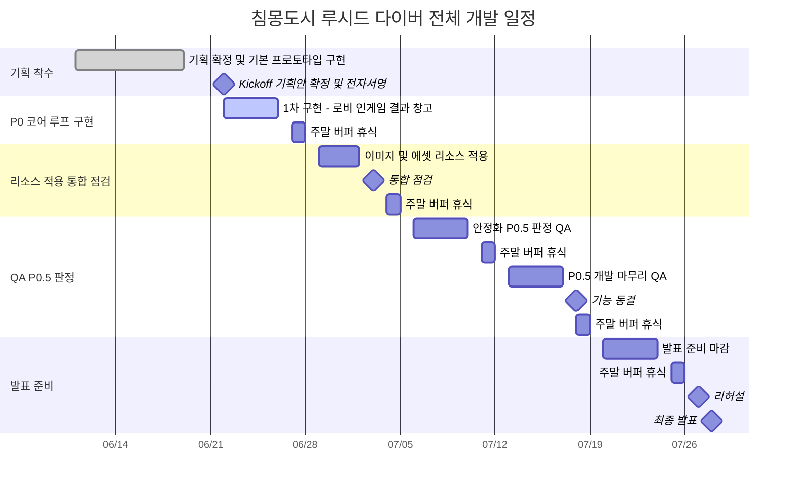


<b>코치님 피드백 (06.22)</b> 2026-06-22

## 요약

### 1) 한 줄 결론 (TL;DR)

- 1주차 P0 Core 1 범위 확정 (로비→인게임→결과창→로비 완전 루프 구현), PPT 비주얼 보강, 캐릭터 동기 개연성 보완, 기획서 전자서명 진행 결정

### 2) 회의 개요

- 일시: 2026-06-22
- 회의 유형: 기획/디자인 리뷰
- 목적: 1주차 P0 범위 확정 및 기획서/PPT 피드백 반영
- 참석자/역할: 코치님(멘토), 프로젝트 팀원들
- 안건(의제):
  - 1주차 완성 목표 및 P0 범위 확정
  - PPT 및 발표 자료 개선 방향
  - 기획서 완성 일정 및 전자서명 계획
  - 캐릭터/시나리오 개연성 보강
  - 플랫폼 사양 명시

### 3) 일정 체크 (Milestone Check)

- <b>현재 기준 단계/주차:</b> 1주차 (06.12\~06.19) 완료, 2주차 (06.22\~06.27) 시작 / P0 Core 1차 구현 착수
- <b>이번 주(또는 이번 단계) 완료 기준(Definition of Done):</b>
  - 로비 씬 → 인게임 → 결과창 → 로비 → 창고까지 완전 루프 구현 (기능 우선, 애셋은 추후)
  - 탈출 성공 루프까지 구현 가능 여부 확인
- <b>이번 회의로 확정된 '다음 점검일/데모'</b>
  - 11시 40분 — 기획서 완성 일정 재논의 — 전체 팀

### 4) 범위/우선순위 통제 규칙 확인 (Scope Control)

- <b>현재 상태 판정:</b> P0 기획 확정 및 개발 착수 준비 단계
- <b>P0.5 통제 규칙 관련 확인</b>
  - 상자 루팅은 P0.5로 분류
  - 1팀 진행으로 FGT 및 베타 없음
- <b>기능 동결(07.18 이후) 관련 확인</b>
  - 해당 없음

### 5) 결정 사항 (Decision Log)

- <b>결정:</b> 프로토타입 정의를 기능 구현에 집중, 애셋 적용은 추후 진행
  - 근거/맥락: 1주차 내 완전 루프 구현 가능성 확보
  - 영향 범위: 개발 일정, 리소스 우선순위
  - 반영 대상: 주별 일정표, 일별 일정표
- <b>결정:</b> PPT는 그림 중심으로 재구성 (한 페이지당 최소 그림 1개)
  - 근거/맥락: 면접관의 이해도 향상, 시각적 전달력 강화
  - 영향 범위: 발표 준비, 리소스 제작
  - 반영 대상: PPT 최종본
- <b>결정:</b> 기획서 완성 후 전자서명 진행
  - 근거/맥락: 계약서 형태로 사인하여 법적 효력 확보
  - 영향 범위: 프로젝트 관리, 책임 명확화
  - 반영 대상: 기획서 최종본
- <b>보류:</b> 기획서 완성 일정
  - 다음 회의에서 결정할 기준/필요 자료: 현재 진행 상황 및 남은 작업량 확인
  - 담당/기한: 11시 40분 재논의

### 6) 액션 아이템 (Action Items → 티켓화 기준)

- [ ] 정확한 컴퓨터 사양 명시 — PC 플랫폼에 윈도우 버전 명시 — 기획서 업데이트 전
- [ ] 채린 캐릭터 이름 변경 검토 — 최종 네이밍 확정 — 기획서 완성 전
- [ ] 다이버들의 다이브 동기 보강 — 필연적 개연성 있는 이유 추가 (예: 감형, 생계 등) — 시나리오 기획서 반영
- [ ] PPT 그림 추가 — 한 페이지당 최소 그림 1개 배치 — PPT 최종 제출 전
- [ ] 노션 정리 — 면접관이 보기 편한 UI/UX 디자인 적용 — 프로젝트 종료 전
- [ ] PPT 폰트 선택 — SF 게임 컨셉에 맞는 폰트 적용 — PPT 최종 제출 전
- [ ] '관제사' 용어 대체 검토 — 더 적절한 SF 용어로 교체 검토 (예: 하이퍼 프레셔 등) — 기획서 반영
- [ ] PPT 14페이지 다이어그램 및 스크린샷 추가 — 감정 변화, 레벨업 과정 등 시각화 — PPT 최종 제출 전
- [ ] PDF 형태로 PPT 제출 — 글꼴 깨짐 방지 — 제출 시
- [ ] 기획서 완성 — 워드 파일 형태 최종본 — 전자서명 전

### 7) 변경 사항/업데이트 (Schedule / Spec Change Log)

- <b>변경 요약:</b> UI 프리팹화 일정을 추후로 연기
- <b>변경 전 → 변경 후</b>
  - UI 작업: 애셋 적용 우선 → 기능 구현 우선, UI 프리팹화는 추후 수정
- <b>영향 받는 마일스톤/검수:</b> 06.27 점검

### 8) 리스크 & 블로커 (Risks / Blockers)

- \[리스크\] PPT 글꼴 깨짐 문제 — 발표 자료 품질 저하 — PDF 변환으로 대응 — 즉시 —
- \[리스크\] 기획서 완성 일정 지연 가능성 — 전자서명 및 개발 착수 지연 — 11시 40분 재논의로 일정 재조정 — 당일 —

### 9) 다음 단계 (Next Steps)

- <b>다음 회의 전까지 확정해야 할 것 1\~3개</b>
  - 기획서 완성 일정 — 전체 팀 — 11시 40분
  - 캐릭터 네이밍 최종 확정 — 담당자 — 기획서 완성 전
  - PC 플랫폼 윈도우 사양 명시 — 담당자 — 기획서 완성 전
- <b>다음 회의 안건 초안</b>
  - 기획서 전자서명 진행 여부
  - 1주차 P0 Core 1 개발 착수 일정

## 메모

<b>일정표</b>

<b>1주차 완성 목표 (P0 코어1 범위) 어디 / 언제까지**19일 현황**\* 무장 획득 상호작용 + 다이버 ↔ 적 공격\*\*\* 무장 발사 시 마나 소비 + 초당 마나 자동 회복\*\*\* 아이템 획득 + 인벤토리 UI 기능(칸 수 조절 + 아이템 드래그 + 인벤토리→퀵슬롯 장착) 구현\*\*\* 21시까지: 아이템 사용\*\* 프로토타입 정의: 애셋 적용(애니메이션 작업)까지? OR 기능 자체에 집중</b>

- 1주차 완성 목표 (P0 코어1 범위) 어디 / 언제까지\* 19일 현황**무장 획득 상호작용 + 다이버 ↔ 적 공격** 무장 발사 시 마나 소비 + 초당 마나 자동 회복**아이템 획득 + 인벤토리 UI 기능(칸 수 조절 + 아이템 드래그 + 인벤토리→퀵슬롯 장착) 구현** 21시까지: 아이템 사용\* 프로토타입 정의: 애셋 적용(애니메이션 작업)까지? OR 기능 자체에 집중
- <b>\* 다음주 예정</b>
- <b>\*\* 탈출 성공 루프까지 구현 가능? (기능만 구현 시)</b>
- <b>\*\* 로비 신부터 → 인게임 → 결과창 → 로비 → 창고까지 완전 루프 / 기능부터 구현</b>
- <b>\*\* UI 프리팹화 → 추후 수정</b>
- <b>\*\* 상자 루팅(0.5)</b>
- <b>\*\* 로비 신 구현 (FGT 라투디)</b>

<b>1팀 진행이라 FGT 및 베타 없음</b>

- 1팀 진행이라 FGT 및 베타 없음

전체 받아쓰기 펼치기

웬만하면 그 금액 안에서 다 진행하면 좋아요. 충분할 거예요. 무료도 쓰고.

운영해줬으면 괜찮을...

주 5일 기준인가요?

그거 어디 갔어요. 아직 안 왔어요.

업무인데 10시 10분.. 혹시 여러분도 그렇나요? 10시에 업무 시작하면 몇 시 전에 와 있어야 되나요?

혹시 여기 10시에 업무 시작이면 10시에 와야 된다는 사람 있나요?

요즘 젠지들 다 그러던데.

이해를 못해서 설명을 해줬더만 이해를 안 하려고 하더라고.

예를 들어서 내가 동사무소에 인감증명서나 10시에 딱 들어갔는데 10시에 같이 출근하는 거예요.

요즘 젠지들은 건물에 들어가는 시간부터가 출근 시간이라고 하더라고.

자 그리고

기획서 관련해서는 따로 업데이트된 게 없습니까?

지금 일전표는 다 봤거든요.

오늘은

혹시 노션 나중에 좀 정리할 거죠? 설마 이대로 쓸 건 아니죠?

이게 면접관이 보기에는 굉장히 불편해요.

전에 내가 줬던 대상받았던 모션이나 취업했던 모션 보면 편하게 되어 있잖아요. 그냥 한 게 아니고 UI나 UX나 면접관이 진짜 보기 좋게 디자인한 거예요. 이왕 하더라도 디자인에 신경을 좀 써야 됩니다.

Hmm.

그리고 CP가 전에는 한번 짰고,

보통 회사는 같아요.

우상혁 디렉터, 이런 일이 생기면 어떻게 합니까, 보통? 이런 일이 있으면 경위서라도 받는 걸로 돼 있습니다. 예를 들면 이런 일이 3회 반복될 경우 직급 해제, 강등, 감봉 필요해요 이제. 아무것도 페널티가 없으니까 이러는 거예요.

내가 좀 재밌는 얘기 하나 해줄까요?

신입들 뽑으면 사내 규칙에다가 서약서를 만들어서 사인 다 받습니다. 지각하면 신입들이니까 인턴들 3개월 동안 교육시켜야 되니까.

음료수 사오기 그래서 음료수 사오기. 나라에서 보내준 사람도 있고, 그중에서 한 세명 정도 정직원으로 뽑습니다.

그러면 정말 이상한 현상이 있었습니다.

너무 웃겼던 게 안 적겠대 이거를.

자기 인생이 어찌될지 모르는데. 그리고 안 나오면 밥 사야 돼요. 아무 이유 없이. 형 그거 싸인 안 한다는 거예요?

Hello.

걔들은 또 어떤 애들은 그거 가지고 딜을 해요. 아니 지각하고 결근 안 하면 되잖아.

그리고 강다영 PD 형태는 좀 잘 들어보면 회사에서 서버 프로그래머라든지. 보안에 관련돼가지고 큰 일 외부 유출 사고가 생기든가 다른 데 팔든가 이러면 큰일 나잖아요. 웬만한 게임 회사들이 블랙슨 기준으로 따지면 피해 금액의 30배를 보상하라고 계약서에 되어 있어요.

근데 안 해요. 왜 안 하냐라니까. 30회는 너무 많대.

그럼 하겠다는 거잖아요.

나중에 얘기해 놓고는 아차 그러네요 또 이러는 거야.

나중에 CPU 오면 그냥 넘어가면 안 되고요. 나는 이런 걸 너무 많이 보기 때문에

예를 들면 회사 직원이 100명이 있으면 워크샵 갑니다. 김포공항에 몇 시까지 오세요. 만약에 탑승 못 하면 전부 다 개인 비용으로 다 하세요 하면 100명 중에 비행기 못 타는 사람 몇 프로 있을까요. 항상 있어요 항상. 한 명도 안 빠지고. 근데 기본적으로 5%는 존재하고요.

그러면 이제 열받아서 회사 그만두는 사람도 있습니다.

나는 그런 게 있습니다. 실수는 누구나 할 수 있어요. 똑같은 실수를 또 하는 것은 나는 범죄라고 생각하거든요.

그런 철저한 서로 간의 규칙들을 고민해 보세요, 여러분. 이게 CP만의 문제가 아니고 여러분도 그럴 수도 있잖아. 그럼 병원 진료 기록하고 처방전 가져오래요.

어떤 애들은 그런 것까지 봤습니까?

지하철이 고장이 나서 늦었다. 그러면 요즘에는 교통공단에다가 때단함 떼줘요.

뭔가 확고한 규칙이 있어야 되기 때문에 처음에 그걸 할까 말까 하다가 말하기도 싫어서 이랬는데 그거는 우리끼리 나중에 협의해봅시다. 여러분 규칙을 정해봐요. 지각하면 어떡해. 프로젝트 하다가 안 하면 어떡해. 이게 우리가 지금 프로젝트 하는 것보다 더 중요해요.

아니면 현업 실무자가 와야 되는데 말도 안 되잖아요. 이런 건 서로 규칙을 정합시다. 반대로 생각해 볼까요? 내가 안 나와요.

내가 맨날 늦어. 나도 욕할 거잖아, 사람들. 이게 약간 이렇게 생각하시면 됩니다. 나의 발전의 시간이 될 수 있겠지만 어떤 사람들한테는 목숨 가도 같은 시간일 수 있어요. 서로 입장이 다르단 말이야. 그 사람 시간까지 피해를 주면 안 된다고 나는 보는 것이지.

이런 말도 안 되는 교장선생님 말씀을 또 해야 돼요. 규칙을 간단하게 정해요. The

10시 출근이다 이러면 한 5분까지는 봐줍시다.

결국 같은 경우에는 어차피 예비군 가야 돼. 그때는 관련 서류 제출하는 걸로. 모든 사람한테까지 적용이 됩니다. 하냐다가 내가 쓰러진 거예요.

강의하다가 내가 쓰러졌어요. 다음 날 아침에 일어났어.

그때 장내시경 받는다고 수면제를 맞았는데, 난 괜찮을 줄 알았거든요. 근데 강의 중에 나도 모르게 잠이 든 거예요.

나중에 알고 봤더만 병원에서 수면제 처방을 너무 강하게 해가지고. 장내시경 받았던 거 다 보내줬어요. 서로 이해하잖아요, 그렇죠?

나도 그런 일이 있었습니다.

嗯。

나는 이런 일이 너무 많아서 당연합니다. 그거는 전혀 신경 쓰지 마요. 그럴려면 이것도 몇 회 이상되면 강등하든지 해야지.

잘 만들었네요, 보통 기획서라 하면. 일단은 저희 안치그래비티에 있습니다. 여기 강의실에 어떻게 공유를 드릴지는 모르겠네요.

내 메일 주소도 보내놨는데. 감추고 뭐 이러면 안 돼. 부끄럽고 이런 거 아니에요. 바닥까지 뒤집어가지고 토시 하나라도 내가 집어줘야 된단 말이지.

Good.

嗯

업데이트하면 일단 인덱스라는 이름으로? 이 파일에서 같이 볼 수 있는 공용 링크 형태로 보낼 방법이 있을까요?

누구한테 물어봤는데?

저도 이쪽에 대해서는 몰라서.

아니 화면 공유해가지고 뭐 간단한 설명을 브리핑을 해주든지 현실적으로 회의 나오고 있거든요. 업로드 안 돼요.

PDF로 보내줄래요? 왜냐하면 PPT로 하면 글꼴이 없으면 깨져서 이상해 보이니까.

그러면 받은 문서를 PDF로.

다운로드가 안 됩니까? 지금 PPT 단계에서 글꼴이 깨진 걸로 출력이 되고 있어서요. PDF는 그걸 상관없이 그냥

PPT에서 PDF로 넘기는 건데 넘기는 단계에서도 깨진 상태로 넘겨집니다.

링크 한번 보내줄래요? 내가 볼 수 있겠지?

지금 이런 식으로 돼있어서 혹시 작동이 안 될 수도 있어서요.

적당히 안 되겠네. 왜 이런 걸 썼지?

PDF로 처음 내면 괜찮을 건데.

편집본으로 말고 읽기 전용으로 제작하자.

PT 여기 피드백 받은 내용들인가요?

PDF로 변환해서 전달드렸습니다.

おっしゃ。

.

같이 보면서 하죠.

나중에 PT에 어울리는 폰트를 잘 찾아봐요. 폰트 자체가 SF게임인데 공손체 느낌이 나면 이상하잖아요. 여기에 잘 맞는 폰트가 분명히 있을 거예요.

배민이나 여기 업체들도 무료로 내놓는 폰트 많잖아요?

여기 관제사란 말이 나오잖아요. 그러면 관제사란 말은 느낌이 우리가 비행기 이런 느낌이거든? 세상에 없었던다 하는데 지어내도 되고. 왜냐하면 관제사이라면 배하고 비행기 항로 결정하고 모니터링하고 이런 사람들은 관제사라는데 SF 개념도 있으니까 직역으로 써놓으니까 이상하거든요. トコンボ

그럴싸한 단어로 한번 구성해보세요. 우리 FPS도 하이퍼 FPS라니까 어떻게 해요? 오버치라는 이런 느낌을 살려서. 주석을 달든지.

이번에 내가 최근에 봤던 영화 중에.

이 단어가 좀 좋겠네.

간단하게 한번 읽어봐요.

전문용어로는 압박. 여기서 말하는 프레셔는 날씨죠. 나도 몰랐는데 이 영화 보고 깜짝 놀랐네. 나는 아무 생각 없이 봤는데 주말에

날씨를 예측하는 군인을 지칭하는 단어를 찾아봐요. 그러니까 예를 들면 옛날에 우리 역사적으로 제일 유명했던 게 노르망딘 상륙작전 있잖아요.

그러면 이날 군인은 한 15만 명. 최대 군함 3천 척, 비행기 1500대 뭐 하여튼 이 날 예를 들면 6월 1일 6시에 노르망디를 가야 돼요. 전 세계 연합군이 다 뭉쳐야 되는데 태풍 오면 어쩝니까? 다 죽잖아요.

모든 사람들은 그냥 무조건 가려고 하는데, 한 명만 반대를 해. 이 영화를 보면 한 명만 반대를 해. 가면 안 된다고, 가면 죽는다고.

그런데 사람들은 그날 가려고 준비도 안 했는데. 기상장교가 누가 임명했냐면 처칠이 임명해놓으니까 아무도 이 말을 거역을 못하는 거야.

결국은 가고 싶은데 얘 때문에 못 갔어요.

근데 내용이 뭐냐면 완전사라는 단어를 이 게임에 맞게 다르게 표현해보라는 거예요. 여기서 말하는 관제사의 의미는 알겠는데 옛날 세계대전 때 전쟁에 필요한 날씨들을 관측했던 사람들을 지칭하는 말인데, 꿈을 해소하러 갈 때 이런 것들을 통제하고 모니터링하고 관제하는 사람들이라고. 하이퍼 프레셔를 해도 되죠. 그냥 얘기하면 재미가 없잖아. 나도 영감을 받아서 얘기하는 거야.

영화도 괜찮았고 마침 또 관제사라는 느낌이 막 단어들이 로봇이 해석한 것처럼 나오잖아요. 그런 느낌 주지 말라는 뜻입니다.

나중에 PT는 좀 더 다듬어야 됩니다. 지금은 좀 러프하게 만들었다고 보고 있기 때문에.

내가 PT나 기획서를 많이 준 이유가 뭐냐면 눈높이를 어느 수준까지 맞추라고 주는 거예요.

플랫폼에 PC라고 되어 있는데 윈도우 얼마 이상? 윈도 얼마 이상.

내 게임 너무 하고 싶어요. 윈도우 98 쓰는데 됩니까? 인도국 폭발차는 데요. 어떻게 할래요?

웃으면 안 돼. 왜냐하면 삼촌 여기 없잖아요. 여러분이 잘못한 거지.

세제나 이런 데는 먹으면 안 됩니다 적혀 있잖아요.

그런 개념입니다.

재밌는 얘기 해주면 그때 중국에 내가 믹스마스터 수출할 때 중국 인구의 천만 명이 15억 인구 중에 천만 명이 윈도98을 써요.

어때요 여러분? 윈도우 98에 맞는 믹스마스터를 개발해야 됩니까?

천만 명인데 천만 명.

고민되죠?

내가 믹스 마스터 처음 만들 때가 다이렉트 6 이상으로 해서 돌아가거든요. 근데 윈도우 98은 다이렉트X가 없어요.

근데 천만 명이래요 조사를 해보니까.

포기했어요. 그런 느낌.

여기 핵심 검증의 의미가 뭐죠?

해킹 방지 열쇠가 뭘까요?

무슨 일 저런 일 모르겠네.

오성혁 디렉터 무슨 의미죠? 옆에 있는 루프가 정동한지를 증명하는 내용으로

um

우와

말이 너무 어려워서 못 알아들을 수 있겠네요.

예를 들면 보상과 보상의 시스템 구조가 완벽하게 구현이 되었는가?

코로나도 이런 거는 볼 게 아니니까.

그리고 이제 파워포인트는 그림이 커야 됩니다. 이거 수정을 좀 해요. 나도 내가 얘기한 거 까먹기 때문에 반드시 메모를 해요.

나중에 손을 좀 보긴 봐야겠지만.

글만 막 변하네.

예를 들면 요런 글 하나 적고 스크린샷 하나 넣고.

사진을 크게 두 개를 배치해가지고.

페이지는 그렇게 안 보이네.

나머지도 피드백한 내용들 급급하게 만들었네.

전체적으로 다시 얘기하는데, 현재는 내용들 쭉 보니까

아직 피드백 받은 거를 반영만 해놓은 상태기 때문에 잘 만드세요. 그리고 체리는 끝까지 쓰기로 했습니까?

그래요. 네이밍 하기가 진짜 힘들어요.

지금 14페이지 내용은 봐서 내가 모르겠거든요, 딴 사람이 봐도.

게임을 해본 사람은 이해하겠는데 하기 전에 이걸 봐가지고는 도저히 모르겠거든요.

그걸로 정확하게 다이어그램으로 표시를 해야지. 면접관이 봐야한다.

감정 변화에 따른 스크린샷도 넣어주든지, 아니면 생성되었을 때, 해금되었을 때, 각각의 레벨업된 과정들을 스크린샷으로 보여주든지.

말만 해가지고는 도저히 이해가 안 가는 부분들이 있기 때문에.

여기서 한번 물어볼게요.

옛날에 나쁜 녀석들이란 영화 보면 한 20년 30년 받은 사람들이 범죄자를 잡으러 가요. 한 명 잡을 때마다 5년씩 감형을 해주니까 잡으러 갑니다. 내가 20년 30년 받았는데 저 새끼 잡아서 성공할 때마다 5년씩 까주는게 얼마나 좋습니까. 여기도 그런 게 있었으면 좋겠다는 거지.

다른 사람을 구조하러 들어간다라고 되어 있는데 아까 얘기했던 영화 스토리를 한번 뭔가 구성해 보라.

내가 처음에는 구조를 받아가지고 어떤 특별한 형태의 개념을 카피를 했는데, 막연한 목표라는 이런 걸 설정해주니까.

지금 이 내용만 가지고는 왜 가는데? 뭐라 대답해줄래?

영화에는 필연적이고 당연하네. 부조만 받았다고 간다? 그러면 보통 양심의 문제잖아요.

왜 이런데?

물 한번 비현상을 넣어보라는.

혹시 저기 애니메이션 좋아하는 사람 있습니까?

그 에반게리온 시리즈를 보면

박사 아들이 생체무기 에반게리온에 탑승해서 무찌르러 가요.

かみゃんじょ

에반게리온으로 타서 사도를 물리치는 게 처음에는 내가 지구를 구하기 위해서 그런 목표란 말이에요. 지구가 없어지면 세상이 망하니까, 그런 인류의 기준으로 다들 전투를 하는데. 애니메이션을 보면 에반게리온 박사 아들은

중간에 번뇌하는 과정이 있어요. 이런 거 보면 아주 필연적이에요. 여러분들한테 물어봐도 대답을 장황하잖아요. 이펙트 있는 내용을.

자, 지금 전체적으로 보면 그림 많습니다. 파워포인트는 그렇게 하면 안 돼요. 그림이 더 많아야죠. 그림이 크고 더 많고 그래야 됩니다.

기획서가 나와야 되는데 기획서 워드 파일로 나온 거 있나요?

지금 우리 6월 11일에 시작했으니까.

기획사가 나와야 지금 일을 할 건데.

DX 언제쯤 나눠주실 수 있을 것 같아요?

지금 금요일자로 동시에 분석 하나 나와 있는데요.

뭡니까?

일단은 9번점 문터에 옮겨져 있는 걸로 보내드렸습니다.

시간을 좀 많이 내서 봐야겠네.

이거 다 만들어지는데 얼마정도 걸릴거 같아요?

우리 사인하기로 했잖아요. 여기다 사인하면 돼요.

내가 그때 그랬잖아요. 원래 항상 그래요. 내가 원했던 거는...

12일 되셨으니까 모레 다른 것 같아.

이거 dx만 날짜 다 잡아먹으면 큰일 나요. 잠깐 쉬고 나서 내가 11시 반? 열한 시 반에 한번 이 기획서 언제쯤 되는지

서로 완벽하게 한번

그거는 해봐요.

GX4 나오면 여기 올려가지고 사인할 겁니다.

현재 만들어놓은 기획서를 계약서처럼 만들어서 사인할 거예요. 가입하면 한 달인가 30번인가 사인 무료예요. 요즘에는 이게 법적 효력도 있습니다.

세상이 많이 바뀌었어요, 여러분.

이거 쓴 지는 내가 벌써 한 3, 4년 된 거 같아요. 옛날에 다 도장 찍고 공증받고 이랬는데.

그래서 계속 다 나옵니다.

언제까지 완성할 것인가?

이번

Абон

GPT

자 이렇게 11시 40분 오늘

자, 5번.

11시 40분까지 했죠? 쉬세요. 11시 40분에 다시 토론합시다, 알겠죠?

Sorry,

정확한  컴퓨터 사양 필요

채린 이름 바꿀 필요 있음

다이버들이 왜 다시 다이브를 하게 되었는가 에 대한 필연적이 이유 필요(어떤 사람은 돈을 벌기 위해 어떤 사람은 범죄의 감형을 위해 처럼 어떠한 필연적인 개연성이 있어야 함)

PPT 에 그림이 너무 적음 적어도 한페이지에 그림이 무조건 하나씩을 들어 갈 수 있도록 만들 것 

<b>침몽도시: 루시드 다이버 팀 회의</b> 2026-06-22

## 요약

### 1) 한 줄 결론 (TL;DR)

- HTML 기획서 Live2D 프로토타입 공유, 점심시간까지 피드백 수렴 후 최종 수정 및 전자서명 진행, 개발 역할 분담(로비씬/전투씬) 확정

### 2) 회의 개요

- 일시: 2026-06-22
- 회의 유형: 개발/기술
- 목적: HTML 기획서 공유 및 피드백, 개발 역할 분담, 오늘 작업 목표 확인
- 참석자/역할: 팀원들 (역할 분담 논의 중)
- 안건(의제):
  - 메인 기획서 완성 일정 및 형식 결정
  - HTML 기획서 Live2D 프로토타입 검토
  - 지각 기준 및 패널티 논의
  - 최소 사양 정의 방법
  - 캐릭터 네이밍 결정

### 3) 일정 체크 (Milestone Check)

- <b>현재 기준 단계/주차:</b> 2주차 (06.22\~06.27) / P0 Core 1차 구현
- <b>이번 주(또는 이번 단계) 완료 기준(Definition of Done):</b>
  - 아이템 사용 기능 구현
  - 탈출 장소를 통한 탈출 판정 및 씬 전환
- <b>이번 회의로 확정된 '다음 점검일/데모'</b>
  - 점심시간 종료 시까지 — HTML 기획서 피드백 검토 — 전체 팀

### 4) 범위/우선순위 통제 규칙 확인 (Scope Control)

- <b>현재 상태 판정:</b> P0 기획 확정 및 개발 본격 착수 단계
- <b>P0.5 통제 규칙 관련 확인</b>
  - 해당 없음
- <b>기능 동결(07.18 이후) 관련 확인</b>
  - 해당 없음

### 5) 결정 사항 (Decision Log)

- <b>결정:</b> HTML 기획서 형식으로 최종 진행, 필요시 워드 문서 병행 제작 가능
  - 근거/맥락: Live2D 프로토타입 포함, 최소/권장 사양 명시, 포트폴리오 활용 가능
  - 영향 범위: 기획서 작성 방식, 전자서명 프로세스
  - 반영 대상: 메인 기획서
- <b>결정:</b> 캐릭터 이름 후보를 퍼린 또는 유안으로 선정
  - 영향 범위: 기획서, 시나리오
  - 반영 대상: 기획서
- <b>결정:</b> 개발 역할 분담 - 로비씬 관리 담당과 전투씬 총괄 분리
  - 근거/맥락: 큰 틀을 로비/전투 씬으로 나눠 효율적 분업 추진
  - 영향 범위: 개발 일정, 인력 배정
  - 반영 대상: 업무보드, 일별 일정표
- <b>보류:</b> 지각 패널티 구체적 방안
  - 다음 회의에서 결정할 기준/필요 자료: 재택 환경에 적합한 패널티 방식 검토
  - 담당/기한: 추후 논의

### 6) 액션 아이템 (Action Items → 티켓화 기준)

- [ ] HTML 기획서에 캐릭터 이름 유안으로 최종 수정 — 기획서 업데이트 완료 — 점심시간 이후
- [ ] 점심시간까지 HTML 기획서 검토 및 피드백 제출 — 피드백 의견 정리 — 점심시간 종료 시
- [ ] 로비 UI 제작용 프리팹 준비 — 프리팹 생성 — 당일 작업 시작 전
- [ ] 탈출씬 UI 작업 (탈출 패널 프리팹 기반) — 코드 연결 완료 — 당일
- [ ] 로비씬 브랜치(5번 로비씬)에서 작업 진행 — 브랜치 작업 완료 — 당일
- [ ] 결과씬 브랜치(4번 리절트 씬)에서 작업 진행 — 브랜치 작업 완료 — 당일
- [ ] 아이템 사용 기능 구현 — 기능 동작 확인 — 당일
- [ ] 탈출 판정 및 씬 전환 구현 — 씬 전환 동작 확인 — 당일

### 7) 변경 사항/업데이트 (Schedule / Spec Change Log)

- <b>변경 요약:</b> 기획서 형식을 워드에서 HTML(Live2D 프로토타입 포함)로 전환
- <b>변경 전 → 변경 후</b>
  - 기획서 형식: 워드 문서 → HTML 기반 문서(Live2D 프로토타입 내장)
- <b>영향 받는 마일스톤/검수:</b> 기획서 확정 및 전자서명 일정

### 8) 리스크 & 블로커 (Risks / Blockers)

- \[리스크\] 기획서 피드백 반영 시간 부족 가능성 — 개발 착수 지연 — 점심시간까지 집중 검토로 대응 — 팀 전체 — 당일 점심시간
- \[블로커\] 구버전 워드 기획서 완성 필요 여부 불확실 — 작업 이중화 우려 — HTML 기획서 우선 진행 후 필요시 워드 제작 — 당일

### 9) 다음 단계 (Next Steps)

- <b>다음 회의 전까지 확정해야 할 것 1\~3개</b>
  - HTML 기획서 최종 수정본 완성 — 담당자 — 점심시간 이후
  - 캐릭터 이름 최종 확정(유안) — 담당자 — 점심시간 이후
  - 개발 인력 배정 완료 — 팀장 — 당일 오후
- <b>다음 회의 안건 초안</b>
  - 기획서 전자서명 진행 여부 확인
  - 로비씬/전투씬 개발 진행 상황 점검

## 메모

전체 받아쓰기 펼치기

Hey.

지금 제가 보내드린 메인 기획서가 구버전 프로젝트 문서 폴더에 있거든요?

그...

아니요. 구버전 프로젝트 문서 폴더에.

워드 문서로 있거든요?

이것도 완성이 되어야 되는데,

Yeah.

멈추고...

그렇죠.

그쵸.

ايه.

저녁은 정확히 몇 시까지인가요?

えっ

Eh.

그렇죠. 이거까지 포함해서 메인 기획서가 언제 나오냐 이거거든요?

어쨌든 메인 기술을 소개하는 PPT니까.

ええ。

Eh...

ええ。

후순위로 내려도 되는구나.

그렇죠?

그렇죠?

오늘 11시까지 저희가 회의에서 받은 거 말씀하시는 건가요?

일단 제가 정리한 거는 대략 이 정도거든요?

Eh.

그렇죠.

Okay.

일단 지각 기준은 어떻게 할까요?

아무래도 저희가 재택으로 받는 거다 보니까 물질적인 피드백은 의미가 없을 거고요.

그렇다고 신혼 시간을 빼는 것도 좀 그렇고 저희가 다 같이 빠지는 것도 그렇다 보니까.

그쵸.

그러게요. 아니면 일을 개발 일지를 한번 더 해달라고 한다던가?

Okay.

で。

그렇죠.

Yeah.

일단은 저희가 유니티 2021로 만드니까 거기에 최소 사양을 정해두는 것부터 시작을 하는게 맞겠죠?

어떻게 하면 좋겠냐는 말을

.

아...

글쎄요, 최소 사양이 딱히 유니티 엔진 버전에 구애받는다기보다는 게임의 무게에 구애받는 거니까, 유니티 2022 버전을 쓴다고 해서 이게 최소 사양이다라고 말하기는 어려울 것 같고. 그렇다기보다는 같은 장르의 동사례를 가져와서 재료 사용의 재능도 합리적이지 않을거라고 생각하긴 합니다.

확실히 저희도 2D랑 3D를 섞어 쓰는 시기니까. 그것도 괜찮은 방법 같습니다.

네네, 우선.

그러게요.

Hmm...

한국 이름으로 할까요 외국 이름으로 할까요?

GPT한테 물어보니까 외국 이름은 약간 이런 느낌인 것 같거든요?

괜찮은 거 같아요.

퍼린이나 유안 중에 하나 고르면 될 것 같긴 한데 어떻게 생각하시죠? 다른 분들은?

Ok

그거는 자유롭게 생각하게 두는 것도 괜찮아 보이고요.

Eh.

만약 저희가 프로젝트를 해외에 수출한다면 서양 쪽이 될까요 동양 쪽이 될까요? 아무래도 저희가 가차 시스템이 들어가 있다 보니까 동양 쪽에 좀 더 많이 집중이 되지 않을까 싶거든요?

확실히 수출 같은 것도 하면은.

Bək çobi naqınagenleyo.

ね。

ええ。

Eh?

えー。

오늘 작업은 저번 주 말씀드렸던 대로 아이템 사용

아이템 사용 기능을 한 후에 탈출 탈출장소를 통해서, 탈출판정하고 씬 넘기는 것까지가 당장에는 목표입니다. 시간이 남으면 더 할 수도 있고요.

で、

네.

네.

그러면 프로젝트의 UICN... 로비 UI 제작하실 수 있게 제가 프랜차이즈 하나 새로 파 드릴게요.

えー

요청.

故障。

Okay.

Eh?

네

이게 정리됩니다.

Oh.

네, 듣고 있습니다.

제가...

중간에 잠깐 말을 끊겠습니다.

지금 방금 말씀하신 그 챗린 이름 제외하고 거의 모든 개선사항을 완료한 html 기획서입니다.

안에 제가 만든 라이브2D 프로토타입도 들어가 있고요.

패키지 형태로 배포도 해놨고 잘 들어가지실 겁니다.

좀 보시면 최소 사항 권장 사양 다 적혀 있고, 시나리오도 제가 의미로 다 바꿨습니다. 그걸로.

이거 저희 개인 포트폴리오 형태로도 쓸 수 있을 거거든요.

이런 형태로 만들긴 했지만.

이거 코치님한테도 보여드리고, 그걸 정해야 될 것 같아요.

정말 죄송합니다. 제가 아침에 일찍 와서 바로 보여드렸어야 되는데.

.

아니 일을 두 번 하게 만들어드려가지고.

점심시간 끝날 때까지 봐주시면 감사할 것 같고요.

코치님 오신 김에 지금 라이브 채팅창에 웹페이지 주소를 하나 보내드렸습니다. 나머지는 이 기획서로 확정을 하기 전에, 팀원들한테도 피드백을 받고 코치님한테도 피드백을 받고, 그래서 이걸로 확정을 할까 했거든요. 일단은 인지를 시키고요. 내용도 설명하고. 어느 회사를 가더라도 사규나 내규나. 이거 기준해가지고 마지막 고민을 해봐요. 마무리 좀 하면 됩니다. 알겠죠?

그래서 가능하면 워드 기획서 말고 그냥 이대로 갈 거고, 많이 필요하다면 워드 같은 것도 제작을 할 수 있습니다. ページ。

이거 AI한테 먹여가지고 이거 기반으로 문서 작성하실 수도 있을 거고

반제사라는 이름이 좀 그렇다고 느끼셨나?

오히려 이것보다 더 직설적이고

좀 더 다르거나 이런 것들도 되게 많긴 한데

라이브2D 만드는데 시간을 너무 많이 써가지고

그림 그리고 라이브2D 관련 프로그램 있어요. 전문 툴로 했어요.

프로토타입이라서 찜빠가 몇 군데 있거든요.

그래도 지각을 했으면 안 되는데.

네.

Ναι.

Hmm, yeah.

잠시만요.

그러니까 일정대로라면 기획서 확정짓고 바로 개발 들어가는 걸 생각하고 있어서.

네네.

어 네

그러면 이렇게 하시죠. 점심시간 이후에 HTML 기반으로 HTML을 최종적으로 수정하고 이름도 유안으로 바뀌었잖아요. 여러 가지 다 수정한 뒤에 문서 작성을 제가 끝내놓겠습니다. 기반으로 사인하고 개발 들어가면 될 것 같은데, 이 거리가

Uh...

이거는 개발을 직접적으로 들어가야 되니까,

아니면 아까 로비 씬을 도와주신다고 했잖아요. 탈출했을 때 UI 좀 만들어주실 수 있나요? 탈출씬 UI에 대해서는 제가 탈출 패널 형태로 프리팹을 뽑아서 별도 브랜치에 넣어놓은 게 있잖아요. 그거를 베이스로 작업을 해드리면 되는 건가요? 일단은 그 캔버스째로 프리팹을 떠놓은 게 있어서 거기다가 코드를 연결을 하는 식으로 작업을 하게 될 것 같거든요?

알겠습니다. 그러면은 그 방식대로 하는 걸로 하고, どう。

그러면 로비 씬을 작업할 브랜치도 필요하니까 저희 루시드다이버 리포지토리에 들어오시면 제가 브랜치를 좀 많이 나눠놨어요. 그중에서 5번 로비씬이라고 하는 친구를 제가 나눠놨거든요. 그래서 로비씬은 여기서 작업하시면 되고, 결과씬은 4번 리절트 씬에서 그대로 작업하시면 될 것 같습니다. 네, 감사합니다.

일단 피드백이 정확히 나오고 나서야 분서 작업에 대한 분배를 조금 더 할 수 있을 것 같아요. 그런 걸 제가 한다고 가정하면 수정되었을 때 작성하는 걸 잠깐 제가 맡겨드려도 될 것 같고요. 물만 좀 빠져있다가 무사작업을 둘이서 마무리 짓고. 어떤 게 좀 좋을지 궁금하긴 했는데.

어쨌든 저희가 큰 틀이 로비랑 전투 씬으로 나뉘어져 있잖아요. 관대형님 바로 다음 순으로 코딩 쪽이나 이런 거에 대해서 좀 더 유능하시다고 제가 생각을 하고 있거든요. 루비씬에 대한 관리를 맡길까 하는 느낌도 있습니다.

그래서 그런 식으로 좀 담당을 나눠서 개발을 총괄을 맡기면 좋지 않을까 하는 생각을 하고 있습니다.

그래서 각각 담당하니까 예를 들어서 담당형 PD님은 전반으로 관리하시지만, 시디님은 로비 씬을 위주로 해서 각자 필요 인력을 말씀해주시면 인력 배정을 시작하고 철저하게 분업으로 개발을 시작하는 거죠. 저는 아무래도 두 개 다 관여를 해야 되긴 할 것 같아요. 전투씬에 들어가는 캐릭터 스프라이트도 만들어야 되니까요. 그래서 대충 그렇게 갈 것 같습니다. 어...

1시까지 기획서 피드백 반영되었나 보는 것은 어불성설 같아요. 식사 맛있게 하세요. ...

# 침몽도시: 루시드 다이버 개발 일정 시각화

## 1. 전체 개발 일정 Gantt Chart

---

## 2. 주별 마일스톤 Roadmap

```mermaid
flowchart LR
    W1["1주차<br/>기획 확정<br/>2026.06.11 ~ 06.19<br/><br/>P0 정의서 확정<br/>기본 인게임 프로토타입 구현"]
    K["Kickoff<br/>2026.06.22<br/><br/>기획안 확정<br/>전자서명 완료<br/>개발 티켓 배정"]
    W2["2주차<br/>1차 구현<br/>2026.06.22 ~ 06.26<br/><br/>로비 → 인게임 → 결과화면 → 창고<br/>P0 코어 루프 구현"]
    B1["주말 버퍼<br/>2026.06.27 ~ 06.28<br/><br/>휴식 / 리커버리"]
    W3["3주차<br/>리소스 적용<br/>2026.06.29 ~ 07.02<br/><br/>로비 이미지<br/>캐릭터 / 아이템 / UI 이미지<br/>맵 레벨 1차 완성"]
    I["통합 / 점검<br/>2026.07.03<br/><br/>리소스 적용 빌드 점검<br/>치명 버그 분류"]
    B2["주말 버퍼<br/>2026.07.04 ~ 07.05<br/><br/>휴식 / 리커버리"]
    W4["4주차<br/>안정화 / P0.5 판정 / QA<br/>2026.07.06 ~ 07.10<br/><br/>P0 QA 진행<br/>P0.5 개발명세서 작성"]
    B3["주말 버퍼<br/>2026.07.11 ~ 07.12<br/><br/>휴식 / 리커버리"]
    W5["5주차<br/>P0.5 개발 마무리 / QA<br/>2026.07.13 ~ 07.17<br/><br/>P0.5 빌드 생성<br/>회귀 버그 수정"]
    F["기능 동결<br/>2026.07.18<br/><br/>신규 기능 개발 중단<br/>버그 수정 중심 전환"]
    B4["주말 버퍼<br/>2026.07.18 ~ 07.19<br/><br/>휴식 / 리커버리"]
    W6["6주차<br/>발표 준비 마감<br/>2026.07.20 ~ 07.24<br/><br/>PPT / 대본 / 시연 영상<br/>백업 빌드 준비"]
    B5["주말 버퍼<br/>2026.07.25 ~ 07.26<br/><br/>최종 컨디션 관리"]
    R["리허설<br/>2026.07.27<br/><br/>발표 동선 점검<br/>Q&A 역할 분배"]
    P["최종 발표<br/>2026.07.28<br/><br/>최종 발표 및 시연<br/>피드백 기록"]

    W1 --> K --> W2 --> B1 --> W3 --> I --> B2 --> W4 --> B3 --> W5 --> F --> B4 --> W6 --> B5 --> R --> P
```

---

## 3. 역할별 Swimlane 표

| 역할 | 1주차기획 확정06.11 \~ 06.19 | Kickoff06.22 | 2주차1차 구현06.22 \~ 06.26 | 3주차리소스 적용06.29 \~ 07.02 | 통합 점검07.03 | 4주차안정화 / P0.5 판정07.06 \~ 07.10 | 5주차P0.5 마무리 / QA07.13 \~ 07.17 | 발표 준비 / 리허설 / 최종 발표07.20 \~ 07.28 |
| --- | --- | --- | --- | --- | --- | --- | --- | --- |
| <b>장수영</b>CPChief Producer | P0 정의서 검수일정표 구조 확정개발 티켓 기준 정리 | 최종 기획안 승인P0 범위 통제 시작 | 코어 루프 구현 범위 승인중간 진행 상황 점검 | 리소스 적용 범위 승인우선순위 조정 | P0.5 진입 가능 여부 1차 판단 | P0 안정화 여부 판정P0.5 착수 승인 또는 폐기 결정 | P0.5 최종 범위 고정추가 기능 요청 차단 | 발표 방향 최종 승인리허설 진행최종 발표 총괄질의응답 조율 |
| <b>우성혁</b>CDCreative Director | 기억 파편창고퀵슬롯정산 규칙 확정 | 핵심 재미와 시스템 방향성 최종 확인 | 로비 → 인게임 → 결과 → 창고 흐름이 게임 의도와 맞는지 검수 | 전체 비주얼 톤UI 톤맵 분위기 검수 | 적용된 리소스가 게임성 / 가독성에 맞는지 검수 | 발표 효과가 큰 P0.5 후보 선정기획 의도 검수 | P0.5 기능이 핵심 재미와 발표 효과에 기여하는지 최종 검수 | 게임 차별화핵심 재미시스템 의도 발표 내용 검수게임성 Q&A 대응 |
| <b>김남해</b>PDProject Director / Producer | 기록 01성공 / 실패 대사귀환 대사 최소 세트 정리 | 콘텐츠 / 시나리오 사용 범위 최종 확인 | 튜토리얼결과창성공 / 실패 상황 문구 최소 세트 제공 및 구현 | 텍스트 / 대사 / 기록이 적용 화면과 충돌하지 않는지 확인 | 대사기록결과창 텍스트 누락 확인 | P0 / P0.5에 필요한 추가 텍스트와 연출 문구 검수 | 추가 텍스트연출기록 관련 내용 최종 확인 | 세계관캐릭터시연 흐름발표 대본 서사 구조 정리서사 Q&A 대응 |
| <b>송예찬</b>PMProject Manager | 캐릭터 / 아이템 / UI 리소스 요구사항 정리 | 전자서명 취합작업 보드 및 티켓 생성 | 작업 진행률 관리블로커 기록1차 빌드 체크리스트 작성 | 리소스 목록 관리파일명 / 규격 / 적용 현황 체크 | 점검 결과 취합버그 목록화다음 주 QA 항목 정리 | QA 시트 운영버그 우선순위 분류P0.5 개발명세서 취합 | P0.5 QA 시트 관리버그 수정 현황 추적RC 빌드 체크리스트 작성 | PPT 취합발표 대본 관리시연 동선 체크리스트 작성백업 자료 관리질문 기록 및 팀 답변 보조 |
| <b>강다영</b>TDTechnical Director | P0 구현 위험 요소 검토개발 작업 분해 | 개발 우선순위 확인구현 순서 확정 | 로비씬인게임씬결과화면창고 저장 흐름 구현 | 로비 이미지캐릭터 이미지아이템 이미지UI 이미지맵 에셋 적용 | 리소스 적용 후 발생한 참조 오류UI 깨짐씬 연결 오류 수정 | P0 버그 수정승인된 P0.5 기능 구현 착수 | P0.5 기능 구현 완료회귀 버그 수정빌드 안정화 | 최종 빌드 확정예비 영상 녹화백업 빌드 준비시연 빌드 실행기술 질문 대응 |

---

## 문서 사용 기준

- <b>전체 개발 일정 Gantt Chart</b>는 README 또는 일정 문서 상단에 배치한다.
- <b>주별 마일스톤 Roadmap</b>은 프로젝트 진행 흐름을 설명하는 섹션에 배치한다.
- <b>역할별 Swimlane 표</b>는 R&R, 역할 분담, 주차별 책임 범위를 설명하는 섹션에 배치한다.
- 일별 작업은 별도 미팅로그 또는 스크럼 로그에서 관리한다.

<b>침몽도시: 루시드 다이버 용어 논의 회의</b> 2026-06-22

## 요약

### 1) 한 줄 결론 (TL;DR)

- 게임 내 리소스 명칭을 '마인드포인트(MP)'로 확정하고, '관제사' 용어는 8시 20분까지 투표를 거쳐 최종 결정하기로 함

### 2) 회의 개요

- 일시: 2026-06-22
- 회의 유형: 기획/디자인 리뷰
- 목적: 게임 용어 체계 정립 및 기획서 반영 사항 확정
- 참석자/역할: 팀원들
- 안건(의제):
  - 관제사/관제자 용어 선택
  - 음역 vs 완역 네이밍 방향성
  - 고유명사 최소화 원칙
  - MP 리소스 명칭 결정
  - 기획서 문서 작업 범위

### 3) 일정 체크 (Milestone Check)

- <b>현재 기준 단계/주차:</b> 2주차(06.22\~06.27) / P0 Core 1차 구현
- <b>이번 주(또는 이번 단계) 완료 기준(Definition of Done):</b>
  - 기획서 용어 통일 완료
- <b>이번 회의로 확정된 '다음 점검일/데모'</b>
  - 8시 20분 — 관제사 용어 최종 투표 — 전체 팀

### 4) 범위/우선순위 통제 규칙 확인 (Scope Control)

- <b>현재 상태 판정:</b> P0 기획 용어 정리 단계
- <b>P0.5 통제 규칙 관련 확인</b>
  - 해당 없음
- <b>기능 동결(07.18 이후) 관련 확인</b>
  - 해당 없음

### 5) 결정 사항 (Decision Log)

- <b>결정:</b> MP(마나) 리소스 명칭을 '마인드포인트'로 확정
  - 근거/맥락: 직관적 이해 가능성, 커뮤니티에서의 자연스러운 사용, 기존 MP 약어 활용 가능
  - 영향 범위: 기획서, 시스템 명세, UI 표기
  - 반영 대상: 메인 기획서
- <b>결정:</b> 고유명사 최소화 원칙 확립
  - 근거/맥락: 플레이어의 직관적 이해도 향상, 진입 장벽 완화
  - 영향 범위: 전체 용어 체계
  - 반영 대상: 기획서 전반
- <b>결정:</b> 서브컬처 네이밍 방향성은 완역 우선
  - 근거/맥락: 서브컬처 장르 문법에 부합
  - 영향 범위: 기획서 용어
  - 반영 대상: 기획서
- <b>보류:</b> 관제사 용어 최종 선택 (관제사 vs 대체안)
  - 다음 회의에서 결정할 기준/필요 자료: 대체 용어 후보(인양사, 꿈지기 등) 검토 후 투표
  - 담당/기한: 8시 20분 투표

### 6) 액션 아이템 (Action Items → 티켓화 기준)

- [ ] 관제사 용어 대체안 검토 및 투표 준비 — 최종 용어 확정 — 8시 20분
- [ ] 기획서에 마인드포인트 명칭 반영 — 기획서 업데이트 완료 — 투표 이후
- [ ] MP 회복 아이템 명칭 변경 (마나석 → 새 명칭) — 아이템 명칭 확정 및 반영 — 기획서 완성 전
- [ ] 웹사이트 유지 및 포트폴리오 대비 정리 — 배포 버전 유지, 개발 화면 업데이트 준비 — 프로젝트 진행 중
- [ ] 규칙 명시 문서 작업 — 문서 작성 완료 — 메인 기획서 반영 전

### 7) 변경 사항/업데이트 (Schedule / Spec Change Log)

- <b>변경 요약:</b> 게임 리소스 명칭 체계 변경
- <b>변경 전 → 변경 후</b>
  - MP 리소스 명칭: (미확정) → 마인드포인트
  - MP 회복 아이템: 마나석 → (확정 대기)
- <b>영향 받는 마일스톤/검수:</b> 기획서 확정 일정

### 8) 리스크 & 블로커 (Risks / Blockers)

- \[리스크\] 관제사 용어 투표 결과에 따른 기획서 전면 수정 가능성 — 기획서 작업 일정 — 8시 20분 투표로 조기 확정 — 당일
- \[리스크\] 용어 변경에 따른 타 문서 정합성 작업 — 문서 간 용어 불일치 — 통합 검수 필요 — 기획서 완성 시점

### 9) 다음 단계 (Next Steps)

- <b>다음 회의 전까지 확정해야 할 것 1\~3개</b>
  - 관제사 용어 최종 확정 — 전체 팀 — 8시 20분
  - 마인드포인트 기획서 반영 — 담당자 — 투표 이후
  - MP 회복 아이템 새 명칭 확정 — 담당자 — 기획서 반영 전
- <b>다음 회의 안건 초안</b>
  - 확정된 용어 기준 기획서 최종 검수
  - 남은 용어 통일 사항 점검

## 메모

전체 받아쓰기 펼치기

규칙 같은 것도 명시할 공간 하나 만들어서 넣어주는 문서 작업, 그리고 정해지면 메인 기획서에 반영하는 거 하나. 크게 이 정도 있는 것 같고, 웹사이트는 안 건드려도 될 것 같아요. 지금 배포 버전 일단 계속 유지하고 실제 게임 개발 화면 나오고 포트폴리오로 쓸 수 있게 정리하면 될 것 같아요. 얘기를 해봅시다. 혹시 좀 생각이 드셨던 분들 있으실까요? 제가 아까 말씀드렸던 건 거의 모든 서브컬처들이 음역이 아니라 완역을 해서 쓰잖아요. 루시드 링크 이런 식으로 한 게 아니라 자각몽 연결자 이런 식으로 완역을 하기 때문에 난 그 문법을 따라간 게 맞지 않을까 생각을 했는데 다른 분들은 아니다.

루시드 링크가 더 좋을 수도 있다 이렇게 의견을 제시할 수도 있잖아요.

사실 완역이니 음역이니 하는 것도 세계관 분위기에 따라서 다르게 선택을 하면 되는 거잖아요? 지금 저희가 쓰고 있는 단어 기조에 대해서는 크게 불만은 없는데, 어떤 단어를 쓸지는 한번 이 기회에 정해보는 게 좋을 것 같아요. 근데 한 가지는 제가 좀 넘어가야 될 게 하나 있는 것 같은데. 이게 이유가 뭐였냐면 관제자 이러면 직급 위에 있는 사람 같고 캐릭터들과 연결되어 있다는 느낌이 안 났거든요.

관제사라는 약간 직업 느낌으로만 부여한다고 생각을 해보니까, 뭔가 캐릭터랑 연관성이 있을 만한 느낌이 드는데, 라고 생각을 했어요. 그래서 지금 아마 들어보셨으면 어느 정도 공감하실 거예요. 그래서 관제자보다 관제사가 낫다는 거. 이거를 일단 기본으로 깔고 저희가 아이디어를 논의해봐야 될 것 같아요.

그래서 제가

그래서 제가 아까 생각했던 게 인양사였거든요? 그래서 인양사라는 것도 어울리긴 하는데 맥락에 따르면 도찐개찐이에요. 그냥 단어 선택만 바뀐 거지.

저는 인양사라고 생각하긴 했었는데, 솔직히 말씀드려서 인양사 할 바에 그냥 관제사 할 것 같습니다. 제가 보기에는 인형사가 관제사보다 덜 어울리는... 꿈지기라고 하면 캐주얼한 게임에 어울릴 것 같은 느낌이고. 약간 세계관이랑 안 어울리는데? 그런 느낌이 들더라고.

이미 맞습니다.

그러면 저희 조건을 하나 걸고 갈까요? 디폴트 관제사로 두고 생각을 하면 좋을 것 같습니다. Hey

만화가 제일 급한 것 같아요, 그렇죠?

그것도 좋죠. 이건 제 지론이거든요. 어떤 매체든 간에 소설이든 게임이든 고유명사 많으면 그냥 안 봐요. 마나는 누구나 다 직관적으로 알 수 있기 때문에 마나라는 선택을 한 건데. 이상한 자기들만 아는 설정 딸쳐놓고 그러면은 그냥 화나요, 저는. 고유명사는 최대한 줄이자가 목표거든요.

확실히 저도 그거에 동의합니다. 영어 같은 거를 굳이 써가지고 멋있게 보이려고 하기보다는 그냥 한국 고유명사 써가지고 담백하게 가는 게... 사실 저희 게임 분위기가 가벼운 것도 아니니까... 통솔하는 사람이 있고 싸우는 사람이 있고 하는 그런 느낌이기도 하니까. 담백하게 가는 게 제일 좋을 거 같긴 합니다.

다른 곳에서도 고유명사로 적당히 쓰면서도 어울리는 걸로 하면 되지 않을까 싶어요.

기억력 같은 것도 있겠구나. 저도 고유명사가 너무 많은 건 안 좋다고 생각하거든요.

제가 딱 그거 생각했거든요.

그런 방향성도 좋습니다. 고유명사도 녹여낼 수 있으니까. 저도 좋다고 생각해요.

긍정적인 대안이라고 생각해요.

솔직히 지금 정신력이니 뭐냐면서 어떤 고유명사였을까? 메모리 포인트는 근데 저희가 수집하는 요소가 기억이다 보니까 메모리라고 하기보다는 멘탈이라던가 좀 더 다른 표현 단어들을 찾아서 넣어주는 게 조금 더 좋을 것 같아요. 그것만 좀 찾으면 될 것 같은데요? 마인드포인트.

마인드 좋네요. 이런 스코어로 넣어놔야겠는데?

애초에 MP라고 영어로 적어놨으면 그냥 마인드 포인트라고 해도 될 것 같아요. 만약에 저희가 상용화한 다음에 커뮤니티에서 얘기할 때 마음력 부족하다 절대 안 그럴 거거든요?

어떻게 보면 마인드포인트 좋은데? 관제사만 좀 생각하는 시간 가져볼게요. 그러니까 50분쯤에 쉬어야 되니까 8시 15분? 20분까지? 그때까지만 말씀해 주시고 거기서 투표 정해서 그냥 관제사 할게 아니면 저희가 골라놓은 것 중에서 하나 골라가지고 관제사 많으면 관제사로 가고,

지금부터 생각 한번 해보시고 20분에 다시 한번 제가 말씀드리겠습니다. 이제 기획서에다가 마인드포인트라는 거 명시해주고

그리고 저거 뭐야.

관제사에서 뭘로 바꿀지 아니면 안 바꿀지. MP 회복 아이템도 마나석에서 이름을 바꿔야 되네요?

이.

Achoo!

그렇죠.

이거는 제가 오늘 끝나고 제가 개인적으로 한번 고민해볼게요. 왼쪽으로 한번 고민해보고 말씀을 드리던가 하겠습니다.

그럼 이제 잠깐 하고 좀 이따가. 20분 내에 뵙겠습니다.

아 시발 유유부거리다가 갑자기 뭔 얘기 하려는지 까먹었다.

엊그제까지 거지였던 내가 이제 200억 중소기업 사장이 된 신세라니. 신고 내셔? 살려주세요! 경찰이다 빨리와! 어쩔 수가 없어! 뭐라는 거야! 뭐야 이 못생긴 놈은!

빨리 커피랑 스프링클러 다 작동시켜야겠다.

누가 내 얘기하나? 돈 좀 보여주세요. 누가 이런 위험한 짓을 이백만 원으로 퉁쳐요. 그거 가져간다고 뭐가 좀 달라져요? 도움이 받아요. 그렇게 이 탕은 협박녀의 연금 멍멍이가 되는 상상을 해봤는데

결국 기탕은 또 한 번 살인을 선택하게 되었죠. 돈 좀 보여주세요. 살인을 목격하고 돈을 뜯어내는 협박범. 비밀 지켜주시는 거죠? 그럼요! 하지만 협박 연애.


